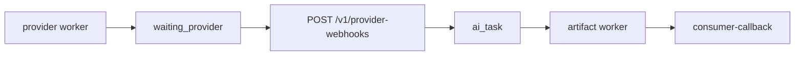

# AI 厂商回调差距

这份清单按 `novelcomic-ai` 的当前代码写。

旧笔记 `docs/opencreator-reference/03-AI网关/03-AI提交轮询Webhook产物与回调/总结.md` 写着进程里没有 callback worker。`novelcomic-ai/apps/worker/src/index.ts` 已经创建 `CallbackWorkerProcessor`，并把它挂在 `consumer-callback` 队列上。那句不要再当缺口。笔记不动。

这一段完成要满足一件事。

KIE 图像任务提交后进入 `waiting_provider`。厂商打到 `POST /v1/provider-webhooks/:provider` 时，服务要按 `ai_task_id` 写回结果，并投入产物队列。没有 repository 的 202 不算结果回来了。

## 已经对齐

这些不用重做。

`POST /v1/tasks` 能校验模型并返回 `ai_task_id`。幂等键重复时返回已有任务，不重复入队。

`apps/worker/src/index.ts` 跑着 provider worker 和 artifact worker。artifact 使用 `PassThroughArtifactStore`。callback worker 使用 `ConsumerCallbackService`，密钥来自 `CONSUMER_WEBHOOK_SECRET`。

`ProviderWebhookService` 在测试里已经能做同一次 attempt 校验、event 去重，并忽略已经离开 `waiting_provider` 的任务。这些分支留在类里。

`CORE_MODELS` 里现有的 KIE 图像 call 是 `webhook`。第二条 Robin call 还没注册。没有第二家时不要改 fallback 状态字。

Consumer 的 `POST /callbacks/models/{vendor}` 仍用原始 body 验 HMAC。这一段不改那条入口。

## 1. API 进程里的 Webhook 没有仓储

类要有 `taskRepository` 才会 `applyProviderResult`。API 启动时没有把仓储传进去。

`apps/api/src/routes/provider-webhooks.ts` 在没传入 `options.service` 时执行 `new ProviderWebhookService()`。`handleWebhook` 发现没有 `taskRepository`，解析完 body 就返回 `accepted`。路由再回 202。

任务因此停在 `waiting_provider`。后面的 artifact worker 和 callback worker 没有输入。

要在注册这条路由时传入和 worker 相同的任务仓储、event 仓储、产物队列。腾讯签名失败仍回 403。Minimax 的 challenge 仍直接回 200，不进仓储。

做完：一条 KIE 成功回调会把任务推进出 `waiting_provider`，并出现一条 artifact job。重复的 `event_id` 不再推进第二次。仓储未配置的分支只留在单元测试里，API 进程不再走到它。

## 2. KIE 的回调地址指向 Consumer

补上仓储之后，KIE 的成功通知仍然到不了 `applyProviderResult`。

OpenCreator 的 `packages/core/src/api/kie/call.ts` 用 `resolveKieWebhookUrl()`。地址是 `PROVIDER_WEBHOOK_BASE_URL + /v1/provider-webhooks/kie`。

NovelComic 的 `packages/core/src/provider/kie_client.ts` 把 `input.webhook_url` 写成厂商的 `callBackUrl`。这个地址来自 Consumer `model_invocation_service.py` 的 `_webhook_url()`，默认是 `{consumer_public_base_url}/callbacks/models/opencreator_ai`。`novelcomic-ai` 的配置里没有 `PROVIDER_WEBHOOK_BASE_URL`。

厂商打到 Consumer。Consumer 要 HMAC，以及 `AiTaskPublicCallbackPayload`。KIE 的原始 body 会 401 或 400。任务停在 `waiting_provider`。

KIE 提交时改用 AI 的 `/v1/provider-webhooks/kie`。Consumer 的 `/callbacks/models/{vendor}` 仍只接收 AI 产物整理之后的 HMAC 回调。

## 补齐顺序

先改 KIE 的 `callBackUrl`，让它打到 `/v1/provider-webhooks/kie`。

再改 `registerProviderWebhookRoutes` 的默认 service 构造，传入任务仓储、event 仓储和产物队列。

不要重写 `POST /v1/tasks`。不要把 `assertTaskStatusCanAdvance()` 接进每条状态写入。不要在这一段给 `CORE_MODELS` 加第二家 Provider。
