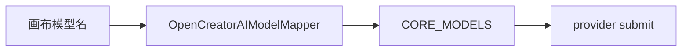

# AI 模型映射差距

这份清单按 `novelcomic-ai` 的注册表和 Consumer 映射写。

厂商回调没有仓储的问题在 `AI厂商回调差距.md`。这里只记画布上的模型名能不能进已经注册的 call。

这一段完成要满足一件事。

`CORE_MODELS` 里启用的模型，Consumer 的 `OpenCreatorAIModelMapper` 都能映射过去。映射不到的名字在进 AI 之前失败，不能当成 KIE 图像提交。

Youchuan 视频两个类继续保持注释，不进入注册表。

## 已经对齐

这些不用重做。

`novelcomic-ai/packages/core/src/models/index.ts` 的 `CORE_MODELS` 里有 `KieImageModel`，以及 Midjourney V8.1、V8.2 的文生图和图生图四条。`youchuan-video.ts` 顶部写明两个视频类不进入注册表。

KIE 图像的 id 是 `kie-image-v1`，别名有 `kie-image`、`z-image`。Consumer `app/services/opencreator_ai/model_mapper.py` 能把这三个名字和若干 config 下的 `default` 映到 `kie-image-v1`。

未映射的名字抛 `MissingOpenCreatorAIModelMapping`。

## 1. Midjourney 进了注册表，画布映射不到

四条 Midjourney 模型的 id 是 `opencreator/text-to-image/midjourney-v8-1` 这一类。它们的 call 在 `packages/core/src/models/midjourney.ts`，provider 是 `youchuan`。`submit()` 现在直接抛出需要 Youchuan 凭证的错误。`normalizeResult()` 固定返回 `processing`。

Consumer 的 `LEGACY_TO_OPENCREATOR_MODEL_ID` 没有这些 id。画布如果选了 Midjourney，会在映射阶段抛 `MissingOpenCreatorAIModelMapping`，到不了 AI。

要先在 mapper 里加上这四个 id 和它们的别名。然后把 `youchuanCall` 的 `submit()` 和 `normalizeResult()` 接到真实的 Youchuan 请求。没有凭证时进程不要假装提交成功。

做完：画布上的 Midjourney id 能通过 mapper。凭证缺失时任务失败，错误里能看到凭证。凭证存在时提交进 `waiting_provider`，后续仍走厂商回调那一清单。

## 2. Midjourney 用了 webhook，OpenCreator 用轮询

上一节把 `normalizeResult()` 固定返回 `processing` 写过了。结果模式也不一样。只补 `submit()` 之后，任务仍会停在处理中。

OpenCreator 的 `packages/core/src/api/youchuan/midjourney-v8-1.ts` 和 `midjourney-v8-2.ts` 把 `result_mode` 写成 `polling`，并有 `getResult` 和 `normalizeYouchuanImageResult`。

NovelComic 的 `packages/core/src/models/midjourney.ts` 把 `result_mode` 写成 `webhook`，没有 `getResult`。`packages/runtime/src/provider-worker.ts` 的 `pollProviderResult()` 因此不会跑这条 call。Youchuan 也没有可接的厂商 webhook。

凭证补上之后，任务会停在 `processing`。

这四条改成 `polling`，并接上 Youchuan 的查询和结果归一。视频两个类继续保持注释。

## 3. 注册表里只有 KIE 和四条 Midjourney

上一节只覆盖已经写进 `CORE_MODELS` 的名字。OpenCreator 能跑的其余模型，NovelComic 既没有 call，也没有 mapper。

OpenCreator 的 `packages/core/src/models/index.ts` 还注册了这些家族：SDXL、Nano Banana、Imagen、Seedream、Flux、GPT Image、Grok Imagine、Qwen、Hailuo、Veo、Wan、Sora、Kling、Vidu、Seedance、Happy Horse、Runway、Luma、Moonvalley、口型、动作、配音、音乐、超分，以及 GPT、Claude、Gemini、Grok、DeepSeek 文本。Consumer mapper 能把画布上的旧名字映到这些 id。Youchuan 视频两个类在两边都保持注释。

NovelComic 的 `CORE_MODELS` 只有 `KieImageModel` 和 Midjourney V8.1、V8.2 的文生图、图生图。`model_mapper.py` 只认识 `kie-image-v1`、`kie-image`、`z-image`。Publisher 内置目录 `BUILT_IN_PUBLIC_MODEL_CONFIGS` 也只有 KIE。

画布或旧工作流选了 Seedream、Kling、Veo 这类名字时，会在进 AI 之前抛 `MissingOpenCreatorAIModelMapping`。默认用户只能跑 KIE 图像。

按 OpenCreator 的家族把 call 和 mapper 补进注册表。没接真实 `submit` 的模型不要注册成已启用。KIE 的 `kie-image-v1` 映射保持不动。Robin 第二条 call 仍等第一家跑通再加。

## 补齐顺序

先补 Midjourney 的 mapper，让四个 id 不再抛缺映射。

再把这四条改成轮询，并接上 Youchuan 的 `submit`、`getResult` 和结果归一。视频类继续留在注释里。

然后按家族补其余已启用模型的 call 和 mapper。没有真实提交实现的不要放进 `CORE_MODELS`。

不要为了这一步改 KIE 的 `kie-image-v1` 映射。KIE 回调地址仍以厂商回调那一清单为准。
