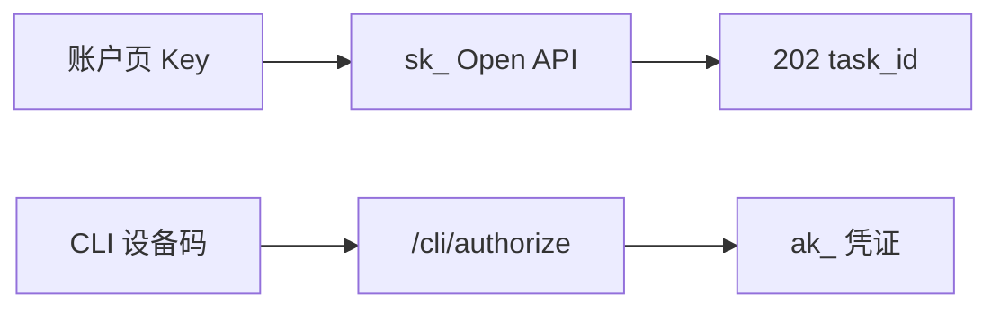

# Developer API 与 CLI 差距

这份清单按当前仓库写。

OpenCreator 的 Key、Open API 和 CLI 在 `opencreator-publisher` 的 `controller/v1/developer_task.py`、`controller/v3/developer_api_client.py`，以及前端 `/cli/authorize`。NovelComic 还没有这些文件。

完整文件顺序已经在 `docs/opencreator-reference/04-商业与外部入口/02-Developer-API与CLI/02.文件编写顺序.md`。这篇只记现在缺什么，以及哪一个现有页面不是这套 API。

这一段完成要同时满足两件事。

账户页能创建 `sk_` Key。外部程序用这把 Key 调用 `/api/developer/v1`，创建 run 得到 `202` 和 `task_id`。另一把 Key 读同一个 `task_id` 得到 404。

CLI 用 `ak_` 走设备码。浏览器打开 `/cli/authorize` 批准之后，CLI 换到凭证。`ak_` 不能打 Open API。

画布自己的 `POST /api/v2/flow/runs` 继续用用户 JWT，不改成 `sk_`。

## 已经对齐

这些不用重做。

登录 JWT、flow project、`FlowService.enqueue_flow_task()` 已经能跑画布 run。Developer 入队以后再复用这套投递，通道用 `api:{task_id}`，不要复用画布的 `workflow:v2` 事件键。

`/developer/apikeys` 路由已经在 `novelcomic-frontend/src/routes/developer.apikeys.tsx`。它只调用 `openApiKeysThenEnterProjects`。`ApiKeysModal` 只有标题和关闭按钮，不创建 Key，也不显示 `sk_`。

仓库里没有 `api_key_hash`、`/api/developer/v1`、`device/code`、`CLI_AUTH_ENABLED`。

## 1. 没有 Key 和 sk_ 鉴权

OpenCreator 先把 Key 文档和 hash 查询写进库，再让 `sk_` 走单独的鉴权，不进 Clerk 中间件的用户白名单。

NovelComic 的认证中间件只认 `__opencreator_jwt`。没有 Developer 路由。

要按编写顺序从 Key 存储写起：hash 查询、`sk_` 鉴权、再挂 `/api/developer/v1`。账户页替换现在的空 `ApiKeysModal`，能创建和撤销 Key。明文只在创建响应里出现一次。

做完：一把 Key 能创建 run 并轮询自己的 `task_id`。另一把 Key 得到 404。用户 JWT 打在 Open API 上不能代替 `sk_`。

## 2. 没有 CLI 设备流

OpenCreator 的 CLI 状态在 Redis。浏览器批准页在登录之后调用设备授权接口。

NovelComic 没有 `features/cli-auth`，也没有 `/cli/authorize`。

Key 和 Open API 能创建 run 之后，再写 Redis 设备码、换证和批准页。不要从批准页开始。

做完：设备码过期不能换证。批准后 CLI 拿到 `ak_`。`ak_` 打 `/api/developer/v1` 被拒绝。

## 3. 有了 `sk_` 之后还缺的 Open API 资源

第 1 节的完成标准是创建 run 并轮询自己的 `task_id`。OpenCreator 的 `/api/developer/v1` 在这一步之外还有这些资源。NovelComic 没有对应文件。

- workflow 的创建、读取、更新，以及从模板创建。参数读取在 `developer_api/services/workflow_runs.py` 的 `get_workflow_parameters()`。
- run 详情里的 `node_statuses`、`current_selection`。另外有 `GET .../results`、`POST .../selection`、`POST .../cancel`。
- Key 上的 `rate_limit_per_minute`。`developer_api/middleware/api_key_auth.py` 的 `get_authenticated_api_client()` 超过限额回 429。

OpenCreator 的这条 Open API 也没有单独的模型列表，也没有开发者 webhook。这两项不要加。

外部程序即使能创建 run，也不能建工作流、读节点入参、提交人机选择、拉产物或取消 run。Key 也没有每分钟限额。

`sk_` 能创建并轮询 run 之后，按这个顺序补 workflow 资源、结果和选择、取消，再补 Key 限额。限额用 Key 文档上的字段，不要另做一套全局配额。

## 补齐顺序

按参考目录里的 Developer 编写顺序，从 Key 文档到 `sk_`，再到 workflow 资源和 `202` 入队。

空的 `ApiKeysModal` 在 Key 接口存在之后再接上。在那之前不要让这个弹窗显示假 Key。

CLI 放在 Open API 能轮询结果之后。内部试跑器放在最后。

workflow 资源、结果、选择、取消和 Key 限额放在 CLI 之前。模型列表和开发者 webhook 不加。
