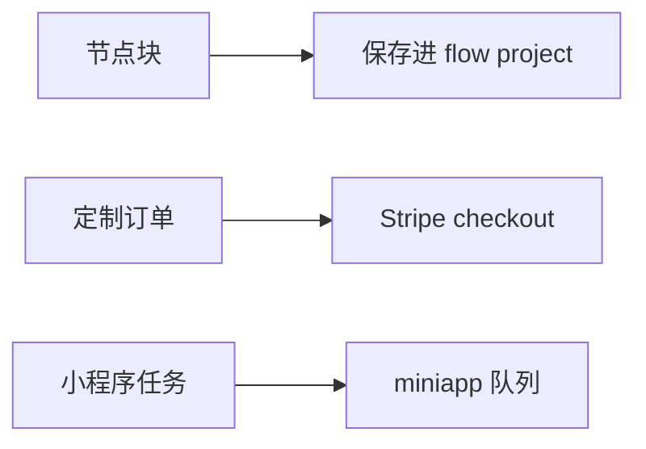

# 小程序、节点块与定制订单差距

这份清单按 Publisher 的产品扩展面写。它们不进入 `POST /api/v2/flow/runs`。

OpenCreator 看 `controller/v1/miniapp.py`、`controller/v1/node_blocks.py`、`controller/v1/custom_workflow.py`。NovelComic 的 `novelcomic-publisher/app` 里没有这三个控制器。

AppFlow 已经在 `app/controller/v3/app_flow.py`。分享读取不依赖 App 记录。这一段不重写 AppFlow。

## 已经对齐

这些不用重做。

`POST /api/v3/app-flow` 能按现有 `flow_id` 存展示配置。没有 App 记录时分享页仍能打开，不把 workflow 当成不存在。

Stripe webhook 见到 `payment_type == custom_workflow` 时不加充值积分，并调用 `send_custom_workflow_order_notification`。通知失败不把订单改回未完成。`app/utils/lark_notify.py` 只负责发卡。

## 1. 没有节点块

OpenCreator 有 `POST /PATCH /DELETE /api/v1/node_blocks` 和 `GET /api/v1/node_blocks/page`。集合是 `node_blocks`。前端积木面板按当前用户分页，工具栏把选中节点存成块。

NovelComic 的画布工具栏没有这块。Publisher 也没有对应路由。

要补 schema、DAO、service、controller。列表、新增、更新、删除都按认证用户的 `user_id` 限制。更新和删除不能只靠路由依赖。

块展开进画布之后，仍走现有的 flow project 保存。节点块本身不是 run 状态。

做完：A 用户看不到 B 用户的块。把块放进画布再保存，`GET /api/v2/flow/project/{flowId}` 能读到这些节点。

## 2. 没有定制订单的创建和查询

OpenCreator 有：

- `POST /api/v1/custom_workflow/checkout`
- `GET /api/v1/custom_workflow/orders`
- `GET /api/v1/custom_workflow/orders/{order_id}`

订单在 `custom_workflow_order`。Checkout 只返回 URL 和订单 id。支付完成以 webhook 为准。

NovelComic 只有 webhook 里的旁路和飞书通知。没有创建订单的接口，用户不能从产品页发起这笔 Checkout，也不能分页查自己的订单。

要补上述三个入口。创建时写入未完成订单。webhook 继续用现在的 `payment_type` 分支结算，不在 checkout 接口里加积分。

做完：未付款的订单查得到，积分不变。付款后的通知失败不把订单改回未完成。

## 3. 没有小程序任务接口

OpenCreator 挂了四个入口：

- `POST /api/v1/miniapp/create_task`
- `GET /api/v1/miniapp/get_task/{task_id}`
- `GET /api/v1/miniapp/get_list/{miniapp_id}`
- `GET /api/v1/miniapp/get_list`

创建后写入 `miniapp_task` 并发布队列消息。OpenCreator 自己的 `tasks/miniapp.py` 仍是占位：主进程没有注册 Miniapp consumer，单独跑也只把状态从 running 改成 completed，不产生业务结果。

NovelComic 连这四个路由都没有。

要补与 OpenCreator 相同的创建和查询。查询按 `user_id` 隔离。执行器保持未注册。不要写一个把任务直接标完成的假 worker 来冒充结果。

做完：已登录用户能创建任务并查到自己的记录。别的用户用同一个 `task_id` 查不到。接口返回不等于小程序已经跑完。

## 4. 节点块和定制订单没有前端入口

上一节补的是 Publisher 路由。页面上也没有调用方。

OpenCreator 的节点块在 `src/api/modules/node.ts`。`node-tool-bar.tsx` 调用 `postNodeBlocks()`，`blocks-list.tsx` 按当前用户分页。定制订单有 `routes/custom-workflow.tsx`、`components/custom_workflow/payments.tsx` 和 `api/modules/custom_workflow.ts`。

NovelComic 的 `canvas-workflow/components` 里没有节点块工具栏，也没有 `postNodeBlocks`。`router.tsx` 没有 `/custom-workflow`。

Publisher 路由接上之后，用户在画布上仍存不了块，产品页也发起不了定制 Checkout，查不到自己的订单。

节点块接口完成后，把工具栏和积木列表面板接上，保存仍走现有 flow project。定制订单接口完成后，再加 `/custom-workflow` 页面，创建只用 checkout 返回的 URL。

Web 前端两边都没有 `/miniapp` 产品页。小程序只补第 3 节的四个查询和创建接口，不补一个新的站内页面。

## 补齐顺序

先写节点块的 schema、DAO、service、controller，再接画布工具栏和积木列表。它只碰画布保存，不碰支付。

再写定制订单的 checkout 和查询，然后接 `/custom-workflow` 页面。webhook 旁路保持不动。

小程序路由放在最后，并且不注册 consumer。不补站内小程序页。
