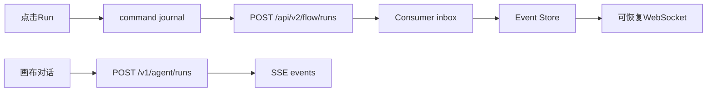

# 执行与实时回程差距

这份清单按当前代码写。

画布 Run 看 `novelcomic-frontend`、`novelcomic-publisher`、`novelcomic-consumer`。Agent 会话看 `novelcomic-agent` 和前端 `src/features/agent-chat`。

旧笔记里有两处已经对不上代码，笔记不动。

`docs/opencreator-reference/02-执行与实时回程/02-工作流命令DAG与HITL/总结.md` 写着 Consumer 只实现 start，没有 `NodeAggregationService`。`novelcomic-consumer/app/tasks/flow.py` 已经处理 start、continue、cancel。`app/services/workflow/node_aggregation_service.py` 已参与模型结果聚合。`selected_outputs` 会写回节点。

`docs/opencreator-reference/02-执行与实时回程/04-Agent会话SSE与运行循环/总结.md` 写着还没有 `POST /v1/agent/runs`。`novelcomic-agent/src/novelcomic_agent/api/server.py` 已经挂了创建 run、events、cancel、cancel-by-request。前端 `agent-chat-stream.ts` 会带 `Last-Event-ID`。

这一段完成要同时满足两件事。

点击 Run 之后，命令进入 Consumer，事件进入 Event Store，前端经可恢复 WebSocket 把节点写成 running 或 success。刷新后用已保存的 cursor 接上，`resume_ready` 之后才把实时事件当成已经接上历史。

画布上的 Agent 对话走已有的 `POST /v1/agent/runs`，再单独订阅 SSE。首页 handoff 触发的 `runAll()` 仍是工作流 Run，不代替 Agent 会话。

## 已经对齐

这些不用重做。

前端 `src/lib/workflow-command-journal.ts` 在超时、断网、5xx 时留下 `command_id`。`src/api/modules/flow.ts` 能创建、继续、取消和查询 active run。

Publisher `app/services/workflow_runs_v2.py` 和 `app/controller/v2/flow_runs.py` 收下命令并返回 `202`、`flow_task_id`、`flow_run_id`、`trace_id`。派发走 Redis Stream `run_flow`。

Consumer inbox 在副作用之前 `claim_command`。continue 走 `FlowNodeStateService.apply_user_selection_for_continue`。cancel 走 `FlowRunStateService.request_cancel`，并调用 `FlowResumeTask._stop_flow_for_kill`。模型结果进 `NodeAggregationService`。

事件经 outbox 进入 `app/services/workflow_event_store.py`。WebSocket 在 `flow_runs.py`。连接会 `claim_connection_generation`，旧 generation 不再写。

前端 `src/lib/workflow-resumable-websocket.ts` 按 `flow_task_id` 建连。首帧认证，随后 `attach_flow`。cursor 存在 `workflow:v2:cursor:{flowTaskId}`。`dispatchEvents` 成功之后才 `saveStoredWorkflowCursor`。handler 抛错时关闭码是 `4002`，不写 cursor。心跳超时会关连接。服务端 `4409` 时清本地 cursor。`resume_ready` 之后才把连接标成完成。`onclose` 不调用 cancel。

`useWebSocketFlow.ts` 分发节点事件。`useWorkflowRunner.ts` 能在刷新后查 active run。`workflow-runtime-provider.tsx` 暴露 `runAll` 和 `stopWorkflow`。

Agent 后端有 `RedisRunStore` 和 `AgentLoop`。旧 `POST /v1/agent/chat` 返回 410 和 `USE_AGENT_RUNS`。工具注册、仓内 Skills、产品 `/api/v3/agent-skills` 已按三层分开。`AgentLoop._connect_mcp()` 直接返回。动态 MCP 不要在这一段打开。

## 1. 画布没有挂上 Agent 会话

运行时文件已经能创建 run 和订阅 SSE。画布上看不见这条链。

OpenCreator 的画布对话调用创建 run 的接口，再用另一条请求订阅 `/v1/agent/runs/{run_id}/events`。刷新时先查 active run，再用 `Last-Event-ID` 续接。取消已知 `run_id` 走 cancel，只有 `client_request_id` 时走 cancel-by-request。

NovelComic 的 `src/features/agent-chat/runtime/use-agent-chat.ts` 已经包了这些调用。仓库里没有别的文件调用 `useAgentChat`。

`src/components/canvas/agent-canvas-layout.tsx` 只包了 `AssistantProvider`。这个 provider 读首页 handoff，然后 `runAll(flowId)`。布局上的按钮也是 `runAll` 和 `stopWorkflow`。

要在画布布局里挂对话面板，面板使用 `useAgentChat`。创建 run 和订阅 events 保持现在 `agent-chat-stream.ts` 里的两次请求。

`AssistantProvider` 继续只消费 `novelcomic:home-agent-handoff`。不要把首页 handoff 改成直接 `POST /v1/agent/runs`，除非产品另行规定首轮输入走对话而不是工作流。

做完：画布上发送一条对话会看到 `POST /v1/agent/runs`，随后有一条 events 订阅。刷新后同一 `run_id` 能从上次的事件 ID 续上。`runAll` 仍只出现在工作流按钮和首页 handoff 里。

## 2. 登录 JWT 还没进这条对话

Agent 现在验 RS256，`user_id` 取 `sub`。前端 `agent-chat.api.ts` 有自己的 token provider。

登录清单里的 `useHttp` 还没统一挂 Bearer。对话请求不要等那个通用封装才发。`useAgentChat` 继续用 `createAgentTokenProvider`，模板仍是 `__opencreator_jwt`。取不到 token 时不创建 run。

做完：未登录打不开对话请求。已登录请求里的 Bearer 能被 Agent 验成 `sub`。别人的 session 仍是 403。

## 3. Continue 选不了候选，选择形状也不对

画布有 Continue 按钮。多结果节点点下去之后，后继吃到的不是用户选中的那一张。

OpenCreator 的 `useWorkflowRunner` 用 `transformUserSelection` 把选择收成按 IO 类型分组的 `{ image: [{ node_id, outputs }] }`，并用 `findNextNode` 算出 `start_ids`。结果挑选在选择条和节点工具栏上。Consumer 组装下游输入时，`selected_outputs` 优先于全部 `outputs`。

NovelComic 的 `agent-canvas-layout.tsx` 在 Continue 时取 `nodeResults[selectNodeId]?.[0]`，整包交给 `continueWorkflow`。请求里的 `user_selection` 是 `{ [nodeId]: selectedOutputs }`，没有 `start_ids`。`flow_resume.py` 的 `_collect_inputs` 只要前驱已经有 `outputs`，就不用这次选择。

多候选节点会把第一条结果，或 `{ run_id, status, outputs }` 这种包装，交给后继。图会继续跑，产物不对。

Continue 前要能按候选勾选。请求改成 OpenCreator 的选择形状，并带上后继 `start_ids`。下游输入优先用这次选中的产物。

## 4. WebSocket 重连复用同一个 `connectionId`

`4002` 不写 cursor、`4409` 清 cursor，这两点和 OpenCreator 一致。重连时的连接身份不一致。

OpenCreator 每次 `openPhysicalSocketOnce` 都 `++socketGeneration`，并新建 `connectionId`。旧 generation 的消息直接丢弃。

NovelComic 的 `workflow-resumable-websocket.ts` 在构造时生成一次 `connectionId`，重连仍用这一条。客户端没有 generation 过滤。服务端 `claim_connection_generation` 会递增 generation，并用 `4001` 踢旧连接。旧 socket 的 `onclose` 只要不是 `4409`，就会再 `scheduleReconnect`。

断线后可能连打。旧帧和新帧会一起改节点状态。

每次物理连接使用新的 `connectionId`。客户端丢掉旧 generation 的消息。被 `4001` 踢掉的旧连接不要再排队重连。

## 5. 祖先失败后的 `stopped` 和模型进度对不上

Consumer 的 `flow_resume.py` 会给被停掉的节点发布 `node_status=stopped`。前端 `dispatchNodeStatus` 只专门处理 ready、running、success、select、pause、failed。`stopped` 落到通用 `onNodeStatus`。`useWorkflowRunner` 没有 OpenCreator 那种 `onNodeStopped`。

OpenCreator 的 `flow_resume.py` 还会发 `llm_model_ready`。NovelComic Consumer 的生产路径没有这个事件。前端 `useWebSocketFlow.ts` 已经能分发 `llm_model_ready` 和 `llm_model_status`，没有发出方。

祖先失败后，子孙节点仍显示 ready 或 running。多模型节点看不到逐模型占位。

`stopped` 要把节点收成停止，并停掉尚未开始的后继。模型进度沿用 OpenCreator 的 `llm_model_ready`，有多个模型调用时再发。

## 6. Agent 工具叫不动画布

第 1 节把对话面板挂上之后，模型仍然不能跑图、不能续跑、也不能发起 HITL。

OpenCreator 的 `run_workflow` 会提交工作流。`continue_workflow` 按 `selected_indices` 续跑。loop 里有 HITL 的 `select` 和 `ask`。

NovelComic 的 `agents/main/profile.py` 只挂了 `ReadFile`、`WebSearch`、`WebFetch`。`continue_workflow` 保持注释。`RunWorkflowTool.execute` 查到流程后返回 `Workflow {flow_id} is ready.`，不入队。`session/manager.py` 把 `allow_attachments` 写成 `False`。

对话里让模型跑当前画布，只会得到一句 ready，节点不会动。

`run_workflow` 要调用现有的 flow run 入队。`continue_workflow` 接上第 3 节的选择。HITL 的提问和选择再打开。动态 MCP 仍保持 `_connect_mcp()` 直接返回。

## 7. Agent run 收不进附件、富文本和空消息

这不是面板没挂上。现有 runtime 的请求体就带不上去。

OpenCreator 的 `AgentRunRequest.message` 允许空字符串。创建 run 时写入 `files`、`rich_text_html` 和 `agent_model`。`WorkflowSelectRequest` 有 `node_id` 和 `selected_indices`。`GenerationConfirmRequest` 有 `group_id`、`action` 和 `params`。确认会唤醒等待中的工具。

NovelComic 的 `AgentRunRequest.message` 是 `min_length=1`。`use-agent-run-controller.ts` 的 `sendMessage` 在 `text.trim()` 为空时直接 return。`WorkflowSelectRequest` 只有 `flow_task_id`。`GenerationConfirmRequest` 只有 `confirm_id`。`generation_confirm` 找到记录后只返回 `status: confirmed`，不恢复 loop。

`core/events.py` 定义了 `WORKFLOW_EVENT_MAP`，仓库里没有引用。loop 不会把节点进度、选择卡、生成确认投进 SSE。

只发图片、只改模型、只带富文本的对话发不出去。确认卡和选择卡点下去也不改画布。

创建 run 接受空消息，并把附件、富文本和 `agent_model` 放进 metadata。选择和确认的请求体补上 OpenCreator 那些字段，确认后恢复等待中的工具。`WORKFLOW_EVENT_MAP` 要真正被 loop 用来投影 SSE。

## 8. 预扣读节点上的 pricing，没有 Redis 就跳过

支付清单里的预扣服务已经在。执行链上的计价来源和失败语义还不对。

OpenCreator 按路由 `metadata.pricing` 和订阅折扣预扣。提交前预扣，成功后还有按 token 的补扣。

NovelComic 的 `InvocationBillingService.reserve_for_node` 读节点上的 `pricing`。`redis_client is None` 时直接不预扣。`perToken` 只在节点 pricing 里出现时才算，没有成功后的补扣。`create_run` 入口也不先查余额。

节点上没写 pricing，或 Consumer 没连上 Redis 时，积分不足的用户仍能把图跑起来。按 token 计价会少扣。

预扣改为读模型路由上的定价，并套用订阅折扣。Redis 不可用时拒绝这次模型提交，不要当成 0 成本。成功后的 token 补扣跟 OpenCreator 的结算走同一笔 `deduction_id`。

## 补齐顺序

先把对话面板接到 `agent-canvas-layout.tsx`，内部只用 `useAgentChat`。

然后确认 token provider 在面板发送前已经注册。没有 token 时按钮保持不可发送。

Continue 补上候选选择和 `start_ids`。WebSocket 每次重连换 `connectionId`，并处理 `stopped`。

Agent 的 `run_workflow` 改为真正入队。run 请求带上附件和富文本。选择、确认和 `WORKFLOW_EVENT_MAP` 接上 SSE。

预扣改读模型定价。没有 Redis 时不要提交模型。

不要新写一条 WebSocket。不要把 `POST /v1/agent/chat` 改回可用。动态 MCP 保持关闭。

亮灯验收如果要在浏览器里再走一遍，路径是：点击 Run，看到节点状态变化，刷新后等到 `resume_ready`，节点仍是运行后的状态。多候选节点 Continue 之后，后继只用选中的那一张。这条验收不新增协议。
