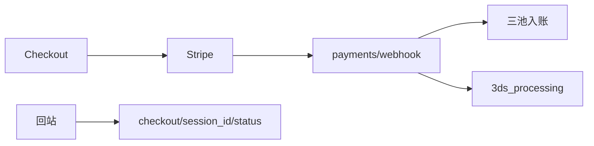

# 支付方式与账单差距

这份清单按两边 Publisher 的当前代码写。

OpenCreator 看 `opencreator-publisher/controller/v1/payments.py` 和 `services/subscription.py`。NovelComic 看 `novelcomic-publisher/app/controller/v1/payments.py`、`app/controller/v2/payments.py`。

结账、Stripe 验签、三池余额、三张历史、预扣和 usage 确认已经在。这里只记还没对齐的支付方式和账单入口。

这一段完成要同时满足两件事。

买积分和订阅能按 OpenCreator 选择卡、支付宝、微信。需要 3DS 时本地状态写成 `3ds_processing`，前端能拿到 `client_secret`。用户能查某次 Checkout 的状态，能开发票、打开账单门户。

微信和支付宝走 Stripe 的 `payment_method_types`，不另接一套支付通道。

## 已经对齐

这些不用重做。

`POST /api/v1/payments/checkout` 创建买积分会话。`POST /api/v2/payments/subscription/checkout` 创建订阅会话。`POST /api/v1/payments/webhook` 验 `Stripe-Signature`，按 `event_id` 去重。

买积分入账在 `CheckoutSessionCompletedProcessor`。订阅发票入账在 `SubscriptionSucceedProcessor.process_event()`。`process()` 仍只做邀请和支付信号，不要把它改成入账。

`GET /api/v2/payments/history`、用量历史和入账历史已经分开。前端有 `/payment-redirect` 和 `/credits/result`。

赠送积分和年付按月的服务已经在。过期赠送退出总额、同一期年付只发一次，用现有服务验收，不新写账本。

## 1. 回站状态、发票和门户没有路由

OpenCreator 的 `controller/v1/payments.py` 还有这些入口：

- `GET /checkout/{session_id}/status`
- `GET /invoice`
- `GET /subscription/template`
- `GET /subscription/stripe_plan_config`
- `GET /portal_session`
- `GET /billing_session`

NovelComic 的 v1 文件只有 `POST /webhook` 和 `POST /checkout`。v2 只有订阅 checkout 和支付历史。

回站页现在只带着 `session_id` 回到站内。余额仍以之后的 `GET /api/v2/user/info` 为准。用户不能按这次会话问 Stripe 状态，也不能打开发票或账单门户。

要按上面的路径补到 `app/controller/v1/payments.py`，并挂进现有 payments router。状态查询只读 Stripe 和本地订单，不在这个接口里加积分。

做完：付款回站能读到这次会话的状态。门户接口返回 Stripe URL。未登录仍是 401。

## 2. 没有支付宝、微信和 3DS 状态

OpenCreator 创建 Checkout 时，`payment_method` 可以是 `alipay`，卡支付的 `payment_method_types` 里包含 `wechat_pay` 和 `alipay`。订阅升级遇到认证时把状态写成 `3ds_processing`。`InvoicePaymentActionRequiredProcessor` 处理 `invoice.payment_action_required`。

NovelComic 的 webhook 处理器只有四个：`CheckoutSessionCompletedProcessor`、`SubscriptionSucceedProcessor`、`SubscriptionDeletedProcessor`、`InvoicePaymentFailedProcessor`。没有 `InvoicePaymentActionRequiredProcessor`，也没有 `SubscriptionUpdatedProcessor`。代码里搜不到 `3ds_processing`、`alipay`、`wechat_pay`。

要补支付方式参数，以及 `invoice.payment_action_required` 的处理器。需要认证时写 `3ds_processing`，响应里留下 `requires_action` 和 `client_secret`。认证没完成不加订阅积分。

做完：支付宝或微信的 Checkout 能创建。3DS 未完成时 `user/info` 不增加可花的订阅积分。

## 3. 换套餐会再开一笔 Checkout

OpenCreator 的 `services/subscription.py` 在 `a_update_subscription_plan()` 里调用 `upgrade_stripe_subscription()` 或 `downgrade_stripe_subscription()`，改现有订阅并做 proration。

NovelComic 的 `app/services/payments.py` 在 `PaymentsService.update_subscription_plan()` 里直接 `create_subscription_checkout_session(..., allow_existing_subscription=True)`。路由在 `app/controller/v2/payments.py`。

已订阅用户点换套餐，会再买一份新订阅。旧订阅不会被改，也不会按剩余时间折算。

升级和降级改现有 Stripe 订阅。需要 3DS 时仍走上一节的 `3ds_processing`，认证完成前不加订阅积分。

## 4. 结账页没有支付方式，也没有优惠码

OpenCreator 的 `payment-redirect.tsx` 在年付或超过阈值的月付时，先让用户选 Stripe、微信或支付宝。创建 Checkout 时 `allow_promotion_codes` 为 true，首月 Starter 会带上 `FIRST_TIME_STARTER_MONTHLY_PROMOTION_CODE_ID`。

NovelComic 的 `payment-redirect.tsx` 在 `createRedirectUrl()` 里拿到参数就创建会话并 `window.location.assign`。页面上没有支付方式选择。`_create_stripe_checkout_session()` 的 payload 没有 `allow_promotion_codes`，也没有 `discounts`。

国内用户看不到微信和支付宝。Checkout 不能输入优惠码，首月折扣也不会自动套上。

回站页在创建会话前展示支付方式。后端按选择写入 `payment_method_types`。Checkout 打开优惠码。首月促销码有配置时写入 `discounts`。

## 5. 站内没有价格表页

OpenCreator 用 `getSubscriptionTemplate()` 和 `getStripePlan()` 喂 `features/billing` 的价格表，展示套餐价、年付折扣和积分额度。

NovelComic 没有这些前端模块。`upgrade-modal.store.ts` 的类型只有 `'' | 'api_keys'`。`router.tsx` 没有定价页。

第 1 节补上 `GET /subscription/template` 和 `GET /subscription/stripe_plan_config` 之后，站内仍没有页面读取和选档。

补一页价格表，数据只来自这两个接口。选档后进入现有的 `/payment-redirect`。

## 补齐顺序

先补 `GET /checkout/{session_id}/status`，回站页改读这个状态。

然后补发票、订阅模板、计划配置、`portal_session`、`billing_session`，并接上价格表页。

换套餐改成更新现有订阅。结账页补上卡、支付宝、微信和优惠码。

最后补 `3ds_processing`。入账仍只在 webhook 验签成功之后。

定制工作流订单的创建接口不在这一段，见独立业务面清单。这里的 webhook 已经能认出 `payment_type == custom_workflow` 并不给充值积分。
