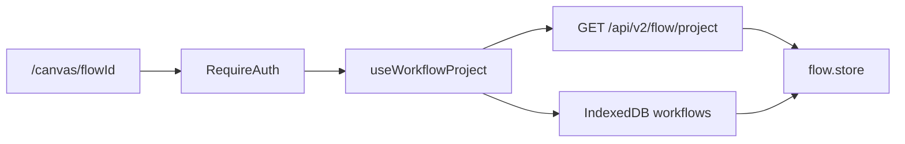

# 画布登录门禁与项目加载差距

这份清单按两边仓库的当前代码写。

OpenCreator 看 `opencreator-frontend` 和 `opencreator-publisher`。NovelComic 看 `novelcomic-frontend` 和 `novelcomic-publisher`。

旧笔记 `docs/opencreator-reference/01-用户入口/02-画布登录门禁与项目加载/总结.md` 还写着可恢复 WebSocket 和分享页不属于这章骨架。WebSocket 在执行回程里已经有协议实现，分享页路由也在。这里只记打开画布、读项目、把图放进 store。那篇笔记不动。

这一段完成要同时满足两件事。

未登录打开 `/canvas/{flowId}` 时只弹登录框。已登录后，`GET /api/v2/flow/project/{flowId}` 按当前用户返回 nodes / edges，并和本机 IndexedDB 里更新的草稿合成一张图，写入画布 store。

打开画布不创建 run，也不连接 WebSocket。

## 已经对齐

这些不用重做。

`novelcomic-frontend/src/routes/canvas.$flowId.tsx` 走 `Protected` 和 `RequireAuth`。未登录打开 `GlobalAuthModal`，不渲染画布。

`src/api/modules/flow.ts` 的 `fetchFlowView` 请求项目时带业务 JWT。`novelcomic-publisher/app/controller/v2/workflow_project.py` 按 `flow_id + user_id` 读取。别的用户用同一个 `flow_id` 读不到。

`src/components/canvas-editor-content/canvasEditorContent.tsx` 在 `useWorkflowProject` 就绪后渲染 `AgentCanvasLayout`。打开画布后按节点批量补拉历史结果。`WorkflowRuntimeProvider` 提供 `runAll()` 和 `stopWorkflow()`，打开页面时不自动跑。

`src/lib/local-db.ts` 已经能按 `flow_id` 存 nodes、edges、`local_updated_at` 和 `sync_status`。`src/lib/sync-manager.ts` 和 `src/lib/flow-persistence.ts` 负责保存前清洗和重试。编辑器那一段已经在用它们。

`src/routes/canvas.view.$flowId.tsx` 是分享只读页，不和编辑页共用这一套读取。

## 1. 项目加载不读本地草稿

服务端项目能进页面。本机还没同步上去的改动，重新打开画布时不会回来。

OpenCreator 的项目加载 hook 会读 IndexedDB。本地 `local_updated_at` 比服务端新，而且状态还是 pending 或 failed 时，用本地 nodes / edges。服务端更新更晚时用接口结果，并写回本地库。

NovelComic 的 `src/features/canvas-workflow/hooks/flow/use-workflow-project.ts` 只读 `getCachedWorkflowProject`，然后 `fetchFlowView`。成功后 `setCachedWorkflowProject`。这个缓存是内存里的。函数不引用 `local-db.ts`。

接口失败时 `workflow` 被写成 `null`，已有的 IndexedDB 草稿也不显示。

要改 `use-workflow-project.ts`。请求发出前读 `local-db` 里同一 `flow_id`。比较 `local_updated_at` 和项目的服务端更新时间。本地更新更晚且 `sync_status` 不是 `synced` 时，先把本地图放进 store，接口返回后再决定留本地还是换服务端。

做完：断网前改过、还没 PATCH 成功的图，重新进入 `/canvas/{flowId}` 仍能看到。已同步的项目以接口为准。

## 2. 旧图兼容不在这次加载里

OpenCreator 加载时还会改旧节点类型和旧模型名，再写入 store。

NovelComic 的这个 hook 把接口 JSON 原样放进 state。`flow.store.ts` 有简化节点的读取，没有在加载时迁移类型或模型名。

旧数据要迁的时候，迁移动作放在这个 hook 写入 store 之前。不要在 `Flow.tsx` 连线时顺手改历史节点。

当前仓库如果没有旧类型样本，这一步先留空函数，不要猜一套映射表。

## 3. 分享只读页不拉历史结果

编辑页会补拉节点结果。只读分享把结果清空，不再请求。

OpenCreator 的 `NodeResultsProvider` 在工作流就绪后调用 `batchFetchAllNodeResults`，并带上 `shareId`。`Input-` 节点不拉。结果回来之前画布继续转圈。

NovelComic 的 `canvasEditorContent.tsx` 在 `readonly` 时执行 `setResults({})`，不调用 `batchFetchAllNodeResults`。`canvas.view.$flowId.tsx` 把分享页以 `readonly` 传进去。编辑页会拉全部节点，也不等结果回来再显示画布。

别人打开分享链接时看不到历史产出。自己的编辑页会先出空节点，结果稍后才补上。

分享页用分享身份拉结果，再渲染画布。编辑页可以继续用当前用户的批量接口。`Input-` 节点不要打进这批请求。

## 4. 打开失败没有分类页

别人的项目、失效分享和坏快照，现在都是一行接口原文。

OpenCreator 的 `canvasEditorContent.tsx` 用 `resolveErrorType` 把业务码 `5000` 收成找不到、`5001` 收成白名单，全屏页提供回首页。

NovelComic 的 `use-workflow-project.ts` 失败后展示 `error.message`。分享页是 `Share load failed`。Publisher `get_workflow_project` 用 HTTP 404 和业务码 `1010`，没有 `5000` 和 `5001`。

要给项目不存在、无权访问、分享失效分别做全屏页，并提供回首页。业务码可以继续用现有的 `1010`，前端按 HTTP 状态和业务码分类，不必改成 `5000`。

## 5. 内存缓存会先画出旧图，打开项目不写 `last_view_time`

OpenCreator 普通打开画布时 `staleTime` 为 0，没有种子缓存就等请求。`GET` 项目会调用 `FlowService.update_workflow_project_last_view_time`。

NovelComic 的 `flow-project-cache.ts` 是模块级 `Map`，没有 TTL。`use-workflow-project.ts` 只要缓存里有图，就把 `isWorkflowReady` 设成 true，先把旧图交给页面，再 `fetchFlowView`。`get_workflow_project` 不更新 `last_view_time`。创建时这个字段是 `None`。

同一页面里再次打开画布，会先闪出上一份图。换账号后如果 `flowId` 还在缓存里，会先闪出上一人的图，等 404 才清空。最近项目如果按 `last_view_time` 排序，打开过的项目不会靠前。

有缓存时仍显示加载，请求返回后再换图。请求失败要清掉这个 `flowId` 的缓存。`GET` 成功后更新 `last_view_time`。

## 6. 复制模板的登录恢复没有过期，失败也不再试

登录清单里写过：复制模板用自己的 `sessionStorage`，不走 `auth-recovery`。恢复本身还有两处会让用户觉得点击没有生效。

OpenCreator 把恢复动作放进 `localStorage` 的 `auth_recovery_action`，5 分钟过期。模板列表到齐后再执行，成功才清除。

NovelComic 的 `use-copy-template.ts` 把 `novelcomic:use-template-preview` 放进 `sessionStorage`，没有过期时间。`useResumePendingTemplateCopy` 一旦 `isSignedIn`，就把 `resumedRef` 设成 true，然后调用 `copyTemplateByShareId`。失败后这次页面生命周期不会再试。只有成功才 `clearPendingTemplateCopy`。

登录框关掉再打开、或复制接口失败时，用户停在原页。同一标签页稍后登录，过期的待复制仍可能突然执行。

恢复动作改到带 5 分钟过期的存储。复制成功才清除。失败保留待执行状态，下次登录还可以再试一次。

## 补齐顺序

先补草稿合并。`use-workflow-project.ts` 读 `local-db.ts`，再和 `fetchFlowView` 的结果比较时间。

然后让分享页拉历史结果，并给打开失败做分类页。

内存缓存改成等请求再换图。`GET` 成功后写 `last_view_time`。

复制模板的待执行记录加上 5 分钟过期。失败可以再试，成功才删除。

旧节点迁移等有样本再写。没有样本不要造映射。

历史结果的用户隔离已经在项目读取这条链上。WebSocket、continue、cancel 不写进这一段。
