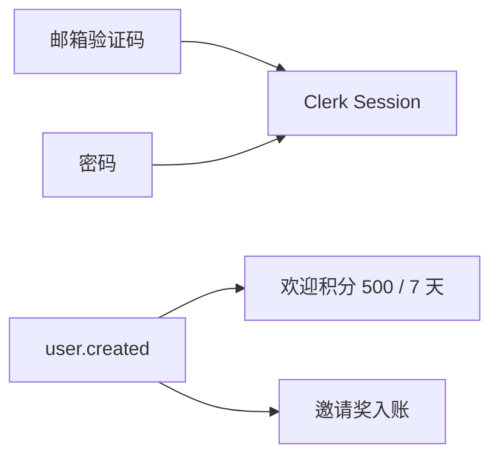

# 登录页全链路与生命周期差距

这份清单按两边仓库的当前代码写。只记还没做的。

OpenCreator 看 `opencreator-frontend` 和 `opencreator-publisher`。NovelComic 看 `novelcomic-frontend` 和 `novelcomic-publisher`。

旧笔记 `docs/opencreator-reference/01-用户入口/01-登录与JWT/总结.md` 和 `04-NovelComic登录与JWT.md` 有落后处，不动它们。文件展开见 [02-文件编写顺序.md](../opencreator-reference/01-用户入口/01-登录与JWT/02-文件编写顺序.md)。

这一段完成要同时达到 [未完成项编写顺序.md](./未完成项编写顺序.md) 第 1 条里还没落地的部分。邮箱验证码和密码还换不成页面上的 Session。邀请奖还没进可花余额。欢迎积分还没按 500、7 天发。回跳、Onboarding、改密、登出、`source` 和登录文案也还没做。

官网定价桥和 `/cli/authorize` 不在这一段。

## 1. 验证码写进 Redis，邮箱里没有信

`app/services/auth_service.py` 用 `random.randint(0, 999999)` 再补成 6 位，所以会出现 `000000` 到 `099999`。码写入 Redis 后立刻 `set_rate_limit`。仓库里没有 `email_service.py`，也没有 SES 调用。`EmailSendError` 在 controller 里有分支，这条函数不会抛它。

发信失败时接口应是 500，同一邮箱可以马上再发。真实邮箱能收到 6 位码，范围从 `100000` 起。发成功后才写 60 秒冷却。

## 2. 登录页只有 Google

没有 `src/api/modules/auth.ts`，也没有 `use-login-page.tsx`。`AuthForm.tsx` 只有「使用 Google 继续」。页面不写 `localStorage.fp_token`，`fp_time` 也没有用 `Intl` 时区。发码 429 时页面不显示剩余秒数。

填邮箱点继续要能拿到 `code_type`。冷却期内看到剩余秒数。

## 3. 验证码和密码换不成 Session

`verify_code_and_login` 在用户不存在时直接抛「用户不存在」，验证码还留在 Redis。页面发不出 `login-with-code` 和 `login-with-password`。没有 `VerifyCodeForm`，60 秒后也不能重发。

已注册邮箱填对码后能 `setActive`。未注册邮箱是 404，Redis 里的码已删。密码路径也能换到 Session。

## 4. 注册没有查重、风控和 metadata 键名

创建前不再查 Clerk。`unsafe_metadata` 仍是 `client_ip`、`invite_code`、`source`。controller 只有异常文案里带「已注册」才回 409，其余创建失败是 500。前端没有注册请求，邀请码也不会进 `register-with-code`。

重复注册是 409，码被删掉。新用户 Clerk metadata 键名是 `fpHash`、`fpTime`、`inviteCode`、`source`。指纹、时区、域名、国家四项只打标，不挡开票。风控命中的用户仍能拿到 `sign_in_token`。

## 5. Google 开始参数还没齐

`OAuthPopupStart.tsx` 只读 `flow_id`，然后 `authenticateWithRedirect`。callback 只有 `flow_id`，没有 `oauth_popup=1`，也没有 `unsafeMetadata`。`sso-callback.tsx` 导出了 `ssoCallbackSplatRoute`，`router.tsx` 只挂了 `ssoCallbackRoute`。开始页不读 `startedAt`，超过 5 分钟仍会开始。邀请、指纹、来源都不在 OAuth 开始参数里，`user.created` 读不到。

Google 新用户的 Clerk metadata 里有指纹、来源和邀请。`/sso-callback/...` 能落到完成页。

## 6. 回跳写死在首页

`SignInPage.tsx` 把 `redirectUrl` 写成 `'/'`。`auth-modal.store.ts` 只有 `isOpen` 和 `onSuccess`。没有 `external-redirect.ts`，没有 `auth-recovery.store.ts`。

`/sign-in?redirect_url=/canvas/xxx` 登录后回到画布。弹窗外链只去白名单域名。10 秒内同址第三次停住。`/auth/success` 调试页可留，不进用户主路径。

## 7. 没有 Onboarding、改密入口，登出也不清缓存

`GlobalAuthModal.tsx` 只有一张 `AuthForm`。没有资料表和欢迎页，也没有 preferences 路由。`change_password` 对空旧密码仍去验密。页面上没有改密入口。

`home-layout.tsx` 的退出只调用 `clerk.signOut({ redirectUrl: '/' })`。没有 `queryClient.clear()`，退出时也不把 `fp_token` 写回。`ClerkProvider` 不跟 locale。`AuthForm` 里的「登录或注册」是写死的中文。

验证码注册成功先填资料、再欢迎页，然后才关窗或回跳。已登录用户能改密，空旧密码跳过验密。登出后回 `/`，指纹还在，React Query 缓存已清。切换英文后，登录页和 Clerk 组件跟 locale 走。

## 8. `user.created` 只插四列，欢迎积分不发

`app/controller/v1/user.py` 只认 `user.created`。已存在就直接返回，邀请绑定不再跑。`UserService.create_user` 只插入 `user_id`、`user_email`、`credits: 0`、`invite_code`。没有 `user.deleted`。webhook 不打异常标，也不发欢迎积分。欢迎积分要单独按 500 点、7 天发，不沿用 `GiftCreditsService` 的 30 天默认。

正常新用户在 `user/info` 里能看到 500 点、7 天内有效的欢迎积分。多邮箱且第一条验证方式是 `email_code` 的用户没有这笔积分。同一条 `user.created` 再来一次，邀请绑定仍会跑。落库带姓名、指纹、时区、`is_abnormal_user`、`system_level`、`source`。

## 9. `user/info` 字段不够

`UserService.get_user_by_id` 只回 `user_id`、`user_email`、`credits`、`invite_code`。缺 `system_level`、`subscription`、`has_3ds_subscriptions`。`InviteSummary` 没有 `invite_link_path`。

`user/info` 带回套餐、3DS 标记和邀请链接。

## 10. 业务请求没有统一带时区

没有 `src/lib/useHttp.tsx`。`client.ts` 不写 `X-Time-Zone`。401 文案是 `Invalid token` 时不清 `clerk_token_cache`。`RequestContext` 只有 `trace_id`。`flow.py` 里项目的 `time_zone` 写的是 `None`。

登录后的业务请求带 `X-Time-Zone`。Publisher 把时区写进 `request.state` 和 `RequestContext`。

## 11. 邀请奖只写记录

`app/services/invite.py` 的 `bind_registered_user` / `reward_paid_user` 只 `insert_credit_record`，不调用 `add_topup_credits`。摘要点数会涨，可花余额不变。记录已在但还没入账时要补发。

`invite_summary` 点数涨的同时，`user/info` 的可花余额也涨。未入账的重复 `user.created` 要补发。注册奖 200，上限 10。

## 12. 模板 `source` 进不了注册和 OAuth

登录页不读 `?source=`，也没有白名单。注册和 OAuth 的 metadata、本地 `users.source` 都还没按这份白名单写。

从模板卡 `?source=template` 进来的新用户，本地 `users.source` 与 Clerk metadata 一致。只接受 `direct`、`template`、`shared_template`，其余写成 `direct`。

## 补齐顺序

上面的编号是缺口。下面这 12 步才是编写顺序，前一步通了再做下一步。顺序与 [02-文件编写顺序.md](../opencreator-reference/01-用户入口/01-登录与JWT/02-文件编写顺序.md) 的 1–12 步一致。

1. 发信。`email_service.py`。发成功才写冷却。验证码 `100000`–`999999`。
2. 前端发码。`auth.ts`、`use-login-page`、邮箱框、指纹和 429。
3. 验证码页。`VerifyCodeForm`。ticket 换 Session。用户不存在先删码。
4. 密码。`AuthForm` 调 `login-with-password`，再换 Session。
5. 注册。查重 409、四项风控、`fpHash` / `fpTime` / `inviteCode` / `source`。请求带邀请码。
6. Onboarding。`auth` 与 `onboarding`。资料表再欢迎页。
7. Google。开始参数里的 metadata、`oauth_popup=1`、`ssoCallbackSplatRoute`。开始页超过 5 分钟不再开始。
8. 回跳。安全 `redirect_url`、`externalReturnUrl`、`auth-recovery`。
9. 改密和登出。`ChangePasswordModal`。空旧密码跳过验密。保留 `fp_token`，清 Query。
10. 登录后契约。`user.created` / `user.deleted`、欢迎积分、`user/info` 缺的字段、`useHttp`、时区中间件。
11. 邀请入账。写记录后 `add_topup_credits`。
12. `source` 白名单，以及登录文案和 Clerk 语言跟 locale。只接受 `direct`、`template`、`shared_template`，其余写成 `direct`。

画布门禁、WebSocket、`ak_` / `sk_` 不写进这一段。
