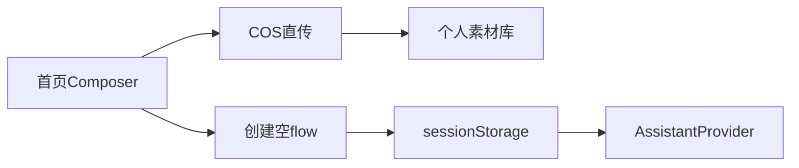

# 首页与 Composer 差距

这份清单按当前前端代码写。

OpenCreator 看 `opencreator-frontend`。NovelComic 看 `novelcomic-frontend`。

旧笔记 `docs/opencreator-reference/01-用户入口/03-前端应用壳首页与Composer/总结.md` 把主链路写成可跑、完整 Composer 还没齐。这条判断还在。笔记里的文件名不动。这里按现在的组件写还缺什么。

这一段完成要同时满足两件事。

首页能表达 OpenCreator Composer 的输入：mention、语义槽位、素材库选择、产品控制、以及 image、audio、video、pdf、markdown。发送后仍创建空 flow，把 handoff 放进 `sessionStorage`，画布按 `flowId` 消费。

Composer 不创建 flow。首页不直接执行 Agent。画布侧按 `flowId` 读 handoff。

## 已经对齐

这些不用重做。

`src/routes/index.tsx`、`src/routes/-components.tsx` 的 `HomeShell`、`src/layouts/home-layout.tsx` 已经在。

`src/lib/home-composer-draft.ts` 保存当前页面生命周期里的文本。`src/components/home/home-page/index.tsx` 管输入、附件、上传和发送。

`src/api/modules/aws.ts` 能要预签名、直传、403 后换签。`src/api/modules/assets.ts` 能把语义槽位写入个人素材库。`use-create-new-flow.ts` 能创建空 flow。

`src/lib/home-agent-handoff.ts` 能保存、按 `flowId` 读取、确认删除、清坏 JSON。`AssistantProvider` 在画布上 peek 同一 `flowId` 的 handoff，调用 `runAll()`，失败不 acknowledge。

## 1. 输入框还是 textarea

OpenCreator 的 mention 输入能插入 Hook、Skill、素材引用，并保留结构化富文本。

NovelComic 的 `src/components/home/home-page/items/home-hero-composer-v4.tsx` 渲染的是 `textarea`。选中 Hook 时，代码会拼一段带 `data-type="mention"` 的 HTML 字符串。页面上没有独立的 `HomeComposerMentionInput`。

要补 mention 输入组件，替换这个 textarea。Hook 和 Skill 的插入结果要进 handoff 的 `richTextHtml`，同时保留现在的纯文本 `text`。

做完：输入框里能留下 mention。刷新首页草稿还在。发送时 handoff 同时有 `text` 和 `richTextHtml`。

## 2. 槽位只打开本地文件

OpenCreator 的槽位可以上传，也可以从个人素材库挑已经入库的附件。产品控制是单独的控制台，标注能回到 Composer。

NovelComic 的槽位是一排按钮加一个隐藏的 `input`。`accept` 来自 `slotConfigs`，现在是图片和视频。仓库里没有 `AssetLibraryPickerModal`，也没有 `ProductControlModal`。

`onSlotUploadingChange` 写在 props 里。组件内部没有调用它。

`ComposerToolbar` 和内容类型条是这个文件里的内联按钮，不是独立组件。`contentTypeOptions` 不区分 audio、pdf、markdown。附件类型是 `image | video | file`。

要补三个组件，挂回 `home-hero-composer-v4.tsx`：

- 素材库选择器，选中后走现有 `assets.ts`，不要再发明一套上传协议。
- 产品控制台，标注结果写回附件。
- 工具条按文件类型拆开 image、audio、video、pdf、markdown。`file` 不再充当这四类的合称。

上传开始和结束时调用 `onSlotUploadingChange`。

做完：槽位能从素材库回填。上传过程中首页能知道还在传。pdf 和音频不会被收成 `file`。

## 3. handoff 附件字段不够

OpenCreator 交到画布的附件带选择来源、控制图来源、控制标注数、预览会话、来源节点、横竖图。

NovelComic 的 `ComposerExternalAttachment` 只有 `id`、`type`、`url`、`previewUrl`、`fileName`、`tag`、`tags`。`HomeAgentHandoffPayload` 在此之外还有 `text`、`agentModelId`、`hook`、`richTextHtml`、`analyticsContext`。

要扩 `ComposerExternalAttachment` 和 handoff 的保存。画布 `AssistantProvider` 读到这些字段后原样交给首轮输入。缺字段的旧 handoff 仍能按现在的 `text` 和 `url` 发送。

做完：从素材库或产品控制台选出的附件，到画布后仍能看出来源。旧的 sessionStorage 记录不会把发送掐断。

## 4. 首页模型下拉接的是节点云模型

OpenCreator 的可选 Agent 模型在 `features/agent-chat/constants/agent-models.ts`，只有 `claude`、`kimi_k3`、`deepseek_v4_flash`。`useAgentModelSelection` 按订阅把权限收成 `loading | free | paid`。免费用户会被 `normalizeAgentModelId` 拉回默认模型。选择写入 `localStorage`。

NovelComic 的 `home-page/index.tsx` 用 `useEnrichedModelsData()`。这份数据是节点用的云模型目录。默认值是 `'novelcomic-default'`，权限只有 `loading | allowed`。刷新不记住选择。`agentModelId` 被 `AssistantProvider` 放进 `runAll` 的 `input_values`。

首页下拉会出现生图、生视频模型。免费用户也能选高价项。到画布后这个 id 不会变成对话模型。

首页改用 Agent 模型目录，并按订阅锁定付费模型。handoff 里的 `agentModelId` 只接受这三档里的 id。

## 5. Hook 和 Skill 是写死的两条

OpenCreator 的 `HookMarquee` 按语言拉取 viral hooks、director seeds 和个人 skills。分类是 directors、hooks、mine。

NovelComic 的 `home-hero-composer-v4.tsx` 把 `hookOptions` 写成 `story-opening` 和 `comic-paneling`。仓库里已有 `fetchViralHooks` 和 director seeds 的 query，Composer 没有引用。

技能条永远是这两个假项。运营改目录之后，首页不会变。

Composer 改为请求现有的 hooks、seeds 和个人 skills。列表可以是空的，不要再留这两条写死数据。

## 6. 未登录可以直接选文件

OpenCreator 的 `handleAttachFiles` 先看登录态。未登录只打开登录框，不把文件放进队列，也不直传。

NovelComic 的同名函数不看 `isSignedIn`。预签名要 JWT，未登录会把附件标成 `hasError`。发送本身在未登录时会开门禁，上传不会。

没登录点附件或槽位，列表里出现上传失败。登录后失败项还在，要手动删掉才能发送。

上传和槽位选择先走登录框。登录成功后再把刚才的文件放进队列。

## 7. handoff 失败被标成 rejected，这次停留不会重试

OpenCreator 等模型权限不再是 `loading` 才读取 handoff。只有发送被接受才 acknowledge。状态仍是 `not_started` 时，`shouldRetryHomeAgentHandoff` 会隔 750ms 再试，最多 2 次。

NovelComic 的 `assistant-provider.tsx` 只判断 `!isRunning`。`runAll` 抛错后把 status 设成 `rejected`。`shouldRetryHomeAgentHandoff` 只对 `not_started` 返回 true，所以失败不会重试。

首轮 `runAll` 因网络或 runner 未就绪失败时，handoff 还在 `sessionStorage`，这次停留的画布是空的。刷新才可能再发。

失败保持 `not_started`，并沿用现在的 750ms、最多 2 次。模型 id 先按第 4 节归一，再交给 `runAll`。

## 8. 首页发送没有分析事件

OpenCreator 在创建 flow 之前上报 `agent_composer_send_click`，带上来源、附件数和 hook。创建成功后再报 `Create_New_Flow`。选 Hook 和点技能另有事件。

NovelComic 只把 `{ source, actionLocation, hasHook, attachmentCount }` 放进 handoff 的 `analyticsContext`。首页 Composer 没有 `postHogCapture`。

发送、选 Hook、点立即使用在分析里都是空的。

发送前补上与 OpenCreator 同名的事件。属性沿用现在 handoff 里已经准备好的计数字段。

## 补齐顺序

先换 mention 输入。textarea 替换完，再补素材库选择器和产品控制台。

然后拆附件类型，并接上 `onSlotUploadingChange`。未登录的上传和槽位先开门禁。

模型下拉改成 Agent 三档，Hook 和 Skill 改成接口数据。

最后扩 handoff 字段。失败保持可重试。发送前补分析事件。`home-agent-handoff.ts` 的保存、读取、坏数据清理保持现在的 key：`novelcomic:home-agent-handoff`。

空 flow 创建和 `runAll()` 消费不要在这一段重写。
