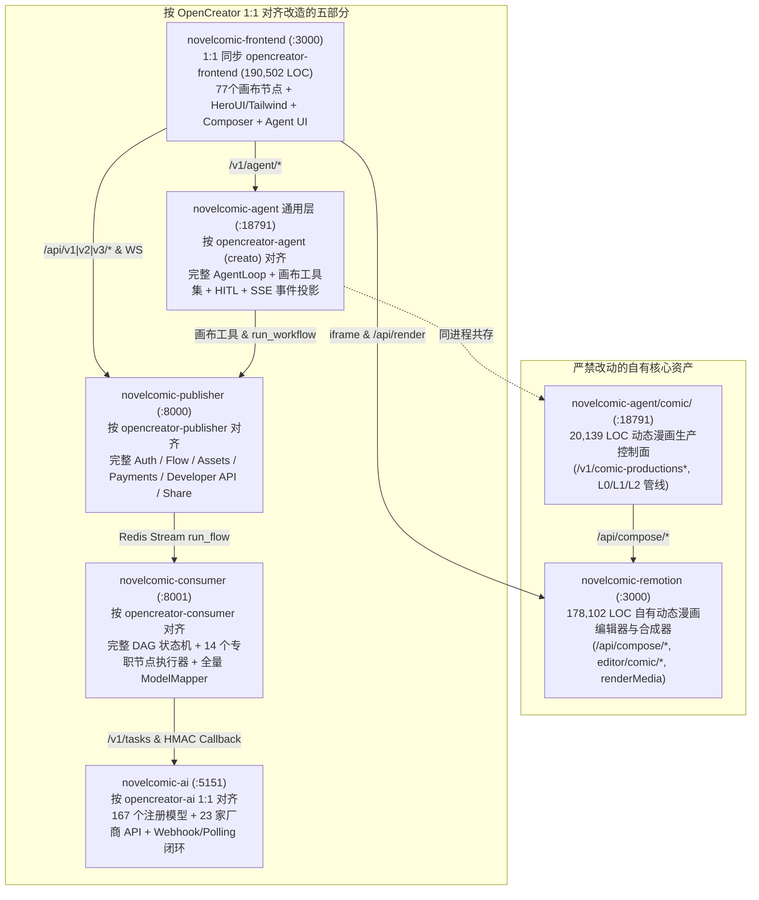

# OpenCreator 与 NovelComic 双项目群全量差距对比与全栈 1:1 对齐改造方案（保留自有 Remotion）

> **核心结论与改造红线**
> 1. **为什么现在 `novelcomic-*` 给人的感觉是“什么都抄了一半，没有任何完整功能”？**
>    因为除了 **`novelcomic-remotion`（178,102 行，我们自己的核心代码）** 和 **`novelcomic-agent/src/novelcomic_agent/comic/`（20,139 行，动态漫画专线）** 是真正针对动态漫画开发的超集模块外，其余五个主体部分都是对 OpenCreator 的**缩水手写重写版**：
>    - **`novelcomic-frontend` 仅占 `opencreator-frontend` 代码量的 20%（38,142 行 vs 190,502 行）**，`src/components` 甚至只有 **9%**（4,979 行 vs 55,447 行）。缺失完整 UI 组件库、77 个专职画布节点（被缩水成 4 个通用白壳）、TipTap 富文本 Composer、`@assistant-ui/react` Agent 交互卡片、素材库 `/assets` 与完整账单页 `/credits`。
>    - **`novelcomic-publisher` 仅占 40%（19,007 行 vs 47,296 行）**，部分业务服务（定制工作流、节点块、小程序、订阅改档、分享与项目分页）为精简版或薄桩实现。
>    - **`novelcomic-consumer` 仅占 30%（7,335 行 vs 24,769 行）**，**缺失全部 14 个专职节点执行器（`tasks/tasks/*`）** 与完整模型映射表。
>    - **`novelcomic-ai` 仅占 24%（14,531 行 vs 59,358 行）**，167 个模型只迁了 7 个，缺失 23 家厂商 API 适配目录（195 个文件）。
>    - **`novelcomic-agent` 通用画布 Agent 核心仅占 10%（3,240 行 vs 33,704 行）**，缺失完整画布操作工具群（`tools/opencreator/*`）、HITL 唤醒恢复与 SSE 工作流事件投影。
> 2. **总体改造原则：`novelcomic-remotion`（及 `agent/comic` 自有代码）严禁改动，其余五仓全部按照 OpenCreator 1:1 对齐改造**
>    - **绝对不动部分**：`novelcomic-remotion` 仓库（1,059 文件 / 178,102 行）是我们自己的核心代码，**一行不动、严禁被 `opencreator-remotion` 覆盖**；同时完整保留 `novelcomic-agent/src/novelcomic_agent/comic/` 动态漫画生产管线及其测试。
>    - **按 OpenCreator 1:1 改造部分**：将 `opencreate/` 下的 `opencreator-frontend`、`opencreator-publisher`、`opencreator-consumer`、`opencreator-ai`、`opencreator-agent`（通用画布层）完整能力按 OpenCreator 标准 1:1 搬迁/对齐到对应的 `novelcomic-*` 仓库中。

---

## 第一章：两个项目群全量规模与改造策略总览

对比基准：
- **源项目群（OpenCreator）**：`/Users/xuankai/Desktop/opencreate`
- **目标项目群（NovelComic）**：`/Users/xuankai/Desktop/opencreator-AI`

### 1.1 子仓库代码量实测对比与改造定性（排除 `node_modules`、`dist`、`.venv`、构建缓存）

| 子系统角色 | OpenCreator 仓库 (`opencreate/`) | OpenCreator 源码规模 | NovelComic 仓库 (`opencreator-AI/`) | NovelComic 源码规模 | NC 占 OC 比例 | 改造策略 |
| --- | --- | ---: | --- | ---: | ---: | --- |
| **Remotion 编辑器** | `opencreator-remotion` | 549 文件 / **98,217 LOC** | `novelcomic-remotion` | 1,059 文件 / **178,102 LOC** | **181%（自有超集）** | **【严禁改动】100% 保留自有代码** |
| **主站前端 App** | `opencreator-frontend` | 941 文件 / **190,502 LOC** | `novelcomic-frontend` | 305 文件 / **38,142 LOC** | **20%** | **按 OpenCreator 1:1 整仓搬迁**（iframe/API 指向本地 `novelcomic-remotion`） |
| **业务网关与 API** | `opencreator-publisher` | 423 文件 / **47,296 LOC** | `novelcomic-publisher` | 187 文件 / **19,007 LOC** | **40%** | **按 OpenCreator 1:1 补齐控制器、服务、DAO 与路由契约** |
| **工作流 DAG 执行器** | `opencreator-consumer` | 193 文件 / **24,769 LOC** | `novelcomic-consumer` | 60 文件 / **7,335 LOC** | **30%** | **按 OpenCreator 1:1 搬入 14 个专职节点执行器、映射表与计费结算** |
| **AI 厂商路由网关** | `opencreator-ai` | 471 文件 / **59,358 LOC** | `novelcomic-ai` | 172 文件 / **14,531 LOC** | **24%** | **按 OpenCreator 1:1 同步 167 个模型、23 家厂商 API 与 Webhook 链路** |
| **Agent 运行时** | `opencreator-agent` | 301 文件 / **86,708 LOC** | `novelcomic-agent` | 218 文件 / **38,764 LOC** | 通用层 **10%** + 自有 `comic` 20k LOC | **通用层按 OpenCreator 1:1 对齐** + **100% 保留自有 `comic/` 模块** |
| **官网与管理后台** | `opencreator-www` / `admin-next` | 774 文件 / **150,091 LOC** | 无 | 0 文件 / **0 LOC** | **0%** | 独立外围仓库，按需后续引入 |

### 1.2 全栈改造后的目标架构图

---

## 第二章：前端（`novelcomic-frontend` ← `opencreator-frontend`）差距与 1:1 改造方案

### 2.1 目录级差距明细

| 目录 / 维度 | `opencreator-frontend` | `novelcomic-frontend` 现状 | NC 占比 | 改造动作 |
| --- | ---: | ---: | ---: | --- |
| `src/` 总计 | 941 文件 / 190,502 LOC | 305 文件 / 38,142 LOC | **20% LOC** | 1:1 同步 `opencreator-frontend/src` |
| `package.json` 依赖 | **118 个包** | 仅部分基础包 | - | 1:1 同步 `package.json`（补齐 TipTap、`@assistant-ui/react`、`@remotion/player`、Konva、i18n、Stripe 等） |
| `src/components` | **243 文件 / 55,447 LOC** | 44 文件 / 4,979 LOC | **9% LOC** | 1:1 覆盖，恢复全部首页、Composer、Navbar、Agent 卡片、UI 组件库 |
| `src/features/canvas-workflow/custom_nodes` | **77 文件 / 16,961 LOC** | 4 文件 / 916 LOC | **5% LOC** | 1:1 覆盖，恢复全部 77 个专职画布节点 UI |
| `src/features/canvas-workflow/panels` | 82 文件 / 26,855 LOC | 29 文件 / 5,551 LOC | **21% LOC** | 1:1 覆盖，恢复节点栏、积木列表、素材栏、结果栏、新手引导 |
| `src/components/agent` + `features/agent-chat` | 134 文件 / 33,518 LOC | 14 文件 / 3,524 LOC | **11% LOC** | 1:1 覆盖，恢复 `@assistant-ui/react` 富交互卡片、思考链、HITL 确认卡 |
| `src/features/billing` + `src/features/assets` | 77 文件 / 15,624 LOC | 9 文件 / 594 LOC | **4% LOC** | 1:1 覆盖，恢复 `/assets` 素材库、`/credits` 套餐与账单页 |
| `styles/` + `src/assets/` + `src/i18n/` | 23 CSS + 160 SVG + 7k 行词典 | 残缺，含 2,880 行手写 `src/index.css` | - | 1:1 覆盖并删除旧 `src/index.css`，彻底消除样式冲突 |

### 2.2 前端 1:1 改造具体步骤

1. **完整同步 `opencreator-frontend` 源码与配置**：
   - 将 `/Users/xuankai/Desktop/opencreate/opencreator-frontend/` 下的 `package.json`、`tailwind.config.ts`、`postcss.config.js`、`components.json`、`vite.config.ts`、`tsconfig.json`、`styles/`、`public/`、`scripts/`、`src/` 1:1 同步至 `novelcomic-frontend/`。
   - 删除 `novelcomic-frontend` 遗留的 `src/index.css`、`src/features/health/`、`src/features/home/TodayImplementationStatus.tsx`。
2. **保留本地服务地址兼容配置（`src/config/index.ts`）**：
   - 让 `src/config/index.ts` 同时兼容 `VITE_PUBLISHER_URL` / `VITE_BACKEND_HOST` / `VITE_SERVER_URL`（默认 `http://localhost:8000`）、`VITE_PUBLISHER_WS_URL` / `VITE_WEBSOCKET_URL`（默认 `ws://localhost:8000`）、`VITE_AGENT_URL`（默认 `http://localhost:18791`）。
   - **关键（对接自有 `novelcomic-remotion`）**：`NEXT_PUBLIC_IFRAME_ORIGIN` 与 `REMOTION_BASE_URL` 指向本地 `novelcomic-remotion` 服务地址（`VITE_NEXT_PUBLIC_IFRAME_ORIGIN` / `VITE_IFRAME_ORIGIN` / `VITE_REMOTION_BASE_URL` / `VITE_REMOTION_URL`，默认 `http://localhost:3000` 或独立端口），前端画布的 `AssembleNowNode` 与 `RemotionFrame` 通过 `postMessage` (`init_data` / `payload_change` / `close_window`) 及 `/api/render`、`/api/progress` 直接与我们自己的 `novelcomic-remotion` 通信，**无需修改 `novelcomic-remotion` 任何代码**。

---

## 第三章：后端四服务（`publisher` / `consumer` / `ai` / `agent`）按 OpenCreator 改造方案

既然前后端全部按 OpenCreator 对齐，我们就不再用前端妥协适配后端残缺接口，而是把四个后端服务直接补齐到 OpenCreator 的完整标准。

---

### 3.1 `novelcomic-publisher` 按 `opencreator-publisher` 改造方案

#### 现状差距（19,007 LOC vs 47,296 LOC）
- **目录结构差异**：`opencreator-publisher` 采用顶层包结构（`controller/`、`services/`、`dao/`、`schemas/`），而 `novelcomic-publisher` 放在 `app/` 下（`app/controller/`、`app/services/` 等）。
- **路由与接口缺口**：
  1. **项目接口缺口**：缺 `GET /api/v2/flow/project/list/page`（分页项目列表）、`DELETE /api/v2/flow/project/{flow_id}`、`GET /api/v2/flow/project/validate/name`；`GET /api/v2/flow/project/{flow_id}` 未更新 `last_view_time`。
  2. **分享接口路由形状差异**：`opencreator-publisher` 的 `controller/v3/share.py` 提供 `GET /api/v3/share/info?share_id=...` 与 `POST /api/v3/share/visit`（Body 传 `share_id`），而 `novelcomic-publisher` 写成了路径参数 `/api/v3/share/{share_id}/info`。
  3. **B2B 信号路由形状差异**：`opencreator-publisher` 提供 `GET /api/v2/b2b-signal/actions/pending-upgrade-popup` 与 `POST /api/v2/b2b-signal/actions/{action_id}/shown`，而 `novelcomic-publisher` 写成了 `/pending` 和 `/shown`。
  4. **Agent Catalog 缺口**：`app/controller/v3/agent_catalog.py` 缺少 `GET /api/v3/agent-catalog/prompt-suggestions`。
  5. **登录、Onboarding 与邀请入账缺口**：
     - `user.created` Webhook 需补齐 500 点 / 7 天欢迎积分发放、风控四项打标（`fpHash`、`fpTime`、`inviteCode`、`source`）与 `user.deleted` 处理。
     - `InviteService.bind_registered_user` / `reward_paid_user` 写记录后需调用 `add_topup_credits` 真正入账可花余额。
     - `GET /api/v2/user/info` 补齐 `system_level`、`subscription`、`has_3ds_subscriptions`、`invite_link_path`。
  6. **支付、账单与订阅改档缺口**：
     - `app/controller/v1/payments.py` 对齐 `opencreator-publisher/controller/v1/payments.py`：补齐 `GET /checkout/{session_id}/status`、`GET /invoice`、`GET /subscription/template`、`GET /subscription/stripe_plan_config`、`GET /portal_session`、`GET /billing_session`。
     - 补齐 `alipay` / `wechat_pay` 支付方式、`allow_promotion_codes`、首月折扣码、`3ds_processing` 状态，以及 `SubscriptionService` 的真实升级/降级折算（而非重新开 Checkout）。
  7. **薄桩服务转正**：将 `node_blocks`、`custom_workflow`、`miniapp`、`developer_api`（`sk_` Open API 含 workflow CRUD、results、selection、cancel、按 Key 每分钟限流）与 `cli`（`ak_` Redis 设备码授权）按 `opencreator-publisher` 的 `services/` 与 `dao/` 完整实现对齐。

#### 改造执行方式
- 保持 `novelcomic-publisher` 的 `app.*` 包前缀与本地启动方式（`uvicorn app.main:app --port 8000`），将 `opencreator-publisher` 的 `controller/{v1,v2,v3}`、`services/`、`dao/`、`schemas/`、`developer_api/` 逐模块同步到 `novelcomic-publisher/app/` 下，消除全部接口形状差异与桩代码。

---

### 3.2 `novelcomic-consumer` 按 `opencreator-consumer` 改造方案

#### 现状差距（7,335 LOC vs 24,769 LOC）
1. **缺失全部 14 个专职节点执行器（`tasks/tasks/*`，3,800+ 行）**：
   - `opencreator-consumer/tasks/tasks/` 包含：`text.py`、`text_to_image.py`、`image_to_image.py`、`video.py`、`media_to_video.py`、`omni_video.py`、`tts.py`、`voice_clone.py`、`generate_music.py`、`image_audio_to_video.py`、`motion_control.py`、`image_angle_control.py`、`video_audio.py`、`split_text.py` 以及 `base_task_node.py`。
   - `novelcomic-consumer` 完全没有 `tasks/tasks/` 和 `tasks/tools/`，所有节点仅靠 119 行的 `ModelInvocationPlanner` 笼统转发，导致复杂节点（分镜拆词、音视频合成、角度/运动控制、多模态组装、变量池替换）无法按 OpenCreator 逻辑运行。
2. **缺失工作流变量状态服务与事件细节**：
   - 缺 `services/workflow/flow_variable_state_service.py`、`services/alert/`、`services/analytics/`。
   - `flow_resume.py` 在多候选 Continue 时需优先消费 `selected_outputs`，在多模型调用时需发送 `llm_model_ready` 事件，在祖先节点失败时正确级联 `stopped` 状态。
3. **模型映射表 `model_mapper.py` 严重缩水**：
   - `opencreator-consumer/services/opencreator_ai/model_mapper.py` 映射了全部模型家族（Midjourney、Seedream、Flux、GPT Image、Kling、Veo、Wan、Sora、Hailuo、Vidu、Runway、Luma、MiniMax、TTS、Music、LLM 等），而 `novelcomic-consumer` 只映射了 `kie-image-v1`。
4. **计费预扣与结算逻辑差距**：
   - 按 `opencreator-consumer` 对齐：从模型路由 `metadata.pricing` 读取价格并应用订阅折扣，无 Redis 时拒绝模型提交，成功后执行按 Token 补扣与同一 `deduction_id` 结算。

#### 改造执行方式
- 将 `opencreator-consumer` 的 `tasks/tasks/`（14 个节点执行器）、`tasks/tools/`、` tasks/events/`、`tasks/flow.py`、`tasks/flow_resume.py`、`services/workflow/`、`services/invocation/`、`services/billing/`、`services/opencreator_ai/model_mapper.py` 完整迁入 `novelcomic-consumer/app/`（统一 `app.` 导入前缀）。

---

### 3.3 `novelcomic-ai` 按 `opencreator-ai` 改造方案

#### 现状差距（14,531 LOC vs 59,358 LOC）
- **两边仓库架构 100% 同构**：均采用 `pnpm` workspace，包含完全相同的包名：`apps/api`、`apps/worker`、`packages/{config,contracts,core,db,errors,observability,queues,runtime,storage}`。
- **核心差距**：
  1. `packages/core/src/models/`：`opencreator-ai` 有 **49 个模型定义文件（注册 167 个模型）**，`novelcomic-ai` 只有 5 个文件（7 个模型）。
  2. `packages/core/src/api/`：`opencreator-ai` 有 **23 家厂商目录（195 个文件）**（`aliyun`、`anthropic`、`baidu`、`byteplus`、`deer`、`fal`、`fish_audio`、`gemini-openai`、`google`、`ideogram`、`kie`、`kling`、`luma`、`minimax`、`openai`、`qnaigc`、`replicate`、`runway`、`shared`、`sufy`、`tencent`、`volcengine`、`xai`、`youchuan`），`novelcomic-ai` **整个 `api/` 目录完全缺失**。
  3. `packages/core/src/provider/`：`opencreator-ai` 有 37 个客户端文件，`novelcomic-ai` 只有 3 个。
  4. `apps/api/src/routes/provider-webhooks.ts`：`opencreator-ai` 已注入真实 `taskRepository`、`providerEventRepository` 与 `artifactQueue`，且 KIE 回调地址使用 `PROVIDER_WEBHOOK_BASE_URL + /v1/provider-webhooks/kie`；`novelcomic-ai` 缺少仓储注入且回调打到了 Consumer。

#### 改造执行方式
1. **1:1 同步 `opencreator-ai` 核心源码**：
   - 将 `opencreate/opencreator-ai/` 的 `package.json`、`tsconfig*.json`、`apps/api`、`apps/worker`、`packages/{config,contracts,core,db,errors,observability,queues,runtime,storage}` 1:1 同步到 `novelcomic-ai/`。
   - 清理 `novelcomic-ai` 源码目录下散落的编译产物 `*.d.ts`。
2. **保留本地开发 COS 模拟路由（可选兼容）**：
   - 在 `novelcomic-ai/apps/api/src/index.ts` 中保留本地磁盘对象存储开发路由（`/api/v2/cos/presign|upload|object`），方便本地无云端 COS 密钥时直传联调。

---

### 3.4 `novelcomic-agent` 按 `opencreator-agent` 改造方案（严保 `comic/` 自有模块）

#### 现状差距与双核结构
- `novelcomic-agent` 包含两套职责：
  1. **通用画布 Agent 核心**（对应 `opencreator-agent/creato/`）：目前在 `novelcomic-agent` 中仅 3,240 行（占 `opencreator-agent` 33,704 行 `core/` 的 10%），缺少 `creato/core/tools/opencreator/`（画布节点增删改查、连线、模型搜索、预估积分等全套画布工具）、`creato/core/context/`、`creato/core/prompt/`、`creato/core/tasks/`、`creato/bus/`、`creato/workflow/`，导致画布 Agent 无法真正操作画布节点、无法发起 HITL 确认与候选选择，也无法将 `WORKFLOW_EVENT_MAP` 投影到 SSE。
  2. **动态漫画生产专线（自有核心代码，严禁丢失）**：位于 `novelcomic-agent/src/novelcomic_agent/comic/`（125 个文件 / 20,139 行）及 `tests/test_comic_*.py`、`tests/test_aliyun_layer.py`、`tests/test_gpt_image_*.py`。

#### 改造执行方式
1. **保护自有动态漫画模块**：
   - **100% 保持不动**：`src/novelcomic_agent/comic/` 全目录、`tests/comic_support.py`、`tests/test_comic_*.py`、`tests/test_aliyun_layer.py`、`tests/test_gpt_image_*.py`，以及 `.env.example` / `config.py` 中的 `COMIC_*`、`COS_*`、`REMOTION_COMPOSE_BASE_URL`、`ALIYUN_VIAPI_*` 配置项。
2. **按 `opencreator-agent` (`creato/`) 1:1 补齐通用画布 Agent 层**：
   - 将 `opencreator-agent/creato/` 下的 `agents/`、`api/`、`bus/`、`config/`、`core/`（含 `tools/opencreator/`、`context/`、`prompt/`、`skills/`、`tasks/`、`memory/`、`pipelines/`）、`dao/`、`database/`、`observability/`、`providers/`、`schemas/`、`security/`、`services/`、`session/`、`utils/`、`workflow/` 同步至 `novelcomic-agent/src/novelcomic_agent/`（将 `from creato.` 统一映射为 `from novelcomic_agent.`，或提供 `creato` 别名包指向 `novelcomic_agent`）。
   - 在 `src/novelcomic_agent/main.py` 中同时挂载：
     - OpenCreator 通用画布 Agent 路由（`/v1/agent/runs`、`/v1/agent/sessions`、`/v1/agent/models`、SSE 事件流、HITL `workflow-select` / `generation-confirm`）。
     - NovelComic 自有动态漫画路由（`/v1/comic-productions*` 及 Stage B/C/D/E 生命周期）。

---

## 第四章：`novelcomic-remotion` 保护红线与跨服务对接边界

### 4.1 为什么 `novelcomic-remotion` 绝对不能动？

- `novelcomic-remotion`（1,059 文件 / 178,102 LOC）是我们針對动态漫画深度开发的超集系统，比 `opencreator-remotion`（98,217 LOC）多出近 **8 万行自有核心代码**：
  - 独有 `src/editor/comic/` 动态漫画领域内核（分镜 Shot 管理、`LayerPackage` L0/L1/L2 多层拆层导入、口型 Sprite 状态机、对白与字幕时间线、`blurred-background-contain` 落幅、`padProjectToMinimumDuration` 短片垫长、批次规划与交付包导出）。
  - 独有 65 个 Next.js API 路由（`app/api/compose/project/*`、`app/api/compose/shot/*`、`app/api/compose/layers/*`、`app/api/compose/dialogue/*`、`app/api/compose/image/sequence`、`app/api/render`、`app/api/progress`）。
  - 独有 `src/editor/workspace/`、`src/editor/tools/`、`src/editor/render-graph/` 完整合成器工作区与本地 `renderMedia` 渲染管线。
- **硬性规定**：在本次及后续的 OpenCreator 对齐改造中，**严禁使用 `opencreator-remotion` 覆盖或修改 `novelcomic-remotion` 的任何文件**。

### 4.2 改造后的其他服务如何与 `novelcomic-remotion` 对接？

1. **`novelcomic-frontend` ↔ `novelcomic-remotion`**：
   - **画布内嵌编辑器 (`iframe_editor.tsx`)**：`opencreator-frontend` 的 `RemotionFrame` 组件通过 `NEXT_PUBLIC_IFRAME_ORIGIN` 加载 `novelcomic-remotion` 页面，双方使用的 `postMessage` 协议（`source: 'remotion-editor'`，`type: 'init_data' | 'payload_change' | 'close_window' | 'posthug'`）完全兼容。
   - **视频合成渲染 (`useRemotionRender.ts` & `assemble.ts`)**：前端通过 `REMOTION_BASE_URL` 调用 `/api/render`（或 `/api/v1/assemble/*`）与 `/api/progress`，直接由本地 `novelcomic-remotion` 处理。
2. **`novelcomic-agent` ↔ `novelcomic-remotion`**：
   - `novelcomic-agent/src/novelcomic_agent/comic/rendering/remotion_client.py` 通过 `REMOTION_COMPOSE_BASE_URL`（默认 `http://127.0.0.1:3000`）调用 `novelcomic-remotion` 的 `/api/compose/*`、`/api/render` 与 `/api/progress` 接口，保持现有契约完全不变。

---

## 第五章：五仓按 OpenCreator 1:1 改造分步执行清单

> **执行前提**：全程不触碰 `novelcomic-remotion/` 目录。

### 第一步：备份各仓 `.env*` 与自有模块
1. 备份 `novelcomic-{frontend,publisher,consumer,ai,agent}/.env*` 本地环境配置。
2. 确认 `novelcomic-agent/src/novelcomic_agent/comic/` 与 `novelcomic-agent/tests/test_comic_*.py` 已处于受保护列表。

### 第二步：改造 `novelcomic-ai`（1:1 同步 `opencreator-ai`）
1. 将 `/Users/xuankai/Desktop/opencreate/opencreator-ai/` 的 `apps/`、`packages/`、`package.json`、`tsconfig*.json` 同步至 `/Users/xuankai/Desktop/opencreator-AI/novelcomic-ai/`，并清除旧的 `.d.ts` 残留文件。
2. 保留本地 `.env.example` / `.env.local`（端口 `5151`、MongoDB `novelcomic`）及本地 COS 开发路由兼容。
3. 执行 `pnpm install && pnpm test` 验证 167 个模型注册表与 Webhook 路由通过。

### 第三步：改造 `novelcomic-publisher`（1:1 对齐 `opencreator-publisher`）
1. 将 `/Users/xuankai/Desktop/opencreate/opencreator-publisher/` 的 `controller/`、`services/`、`dao/`、`schemas/`、`developer_api/`、`middleware/`、`social/`、`tasks/`、`utils/` 同步对齐至 `novelcomic-publisher/app/` 下。
2. 统一内部导入路径为 `app.*`（或在 `novelcomic-publisher` 根路径配置 `PYTHONPATH=.` 兼容顶层导入），保留 `app/config.py` 对本地 `.env.local` 的读取。
3. 运行 `pytest` 验证 Auth、Flow Project（含 `/list/page`、`/validate/name`、`DELETE`）、Share v3、Payments、Developer API (`sk_`)、CLI (`ak_`)、Node Blocks、Custom Workflow 全部就绪。

### 第四步：改造 `novelcomic-consumer`（1:1 对齐 `opencreator-consumer`）
1. 将 `/Users/xuankai/Desktop/opencreate/opencreator-consumer/` 的 `tasks/tasks/`（14 个专职节点执行器）、`tasks/tools/`、`tasks/events/`、`tasks/flow.py`、`tasks/flow_resume.py`、`services/`、`dao/`、`schemas/`、`model_gateway/`、`utils/` 同步至 `novelcomic-consumer/app/`。
2. 同步完整的 `OpenCreatorAIModelMapper` 与按路由定价预扣/结算逻辑。
3. 运行 `pytest` 验证 DAG 执行、14 类节点执行器、多候选 Continue、HMAC 回调与积分结算通过。

### 第五步：改造 `novelcomic-agent`（对齐 `opencreator-agent` 通用层 + 保留 `comic/`）
1. 将 `/Users/xuankai/Desktop/opencreate/opencreator-agent/creato/` 的通用画布 Agent 模块同步至 `novelcomic-agent/src/novelcomic_agent/`（绝不覆盖 `comic/` 子目录）。
2. 在 `novelcomic-agent/pyproject.toml` 中合并 `opencreator-agent` 的依赖与 `novelcomic-agent` 的 `comic` 依赖（`asyncpg`、`qcloud-cos-v5`、`opencv-python-headless`、`pillow`、`aliyun-python-sdk-core`）。
3. 在 `src/novelcomic_agent/main.py` 中同时挂载 `/v1/agent/*`（通用画布 Agent）与 `/v1/comic-productions*`（动态漫画专线）。
4. 运行 `pytest` 验证通用 Agent 会话/工具测试与全部 `test_comic_*.py` 测试同时通过。

### 第六步：改造 `novelcomic-frontend`（1:1 搬迁 `opencreator-frontend`）
1. 将 `/Users/xuankai/Desktop/opencreate/opencreator-frontend/` 的 `package.json`、`tailwind.config.ts`、`postcss.config.js`、`components.json`、`vite.config.ts`、`styles/`、`public/`、`scripts/`、`src/` 1:1 同步至 `/Users/xuankai/Desktop/opencreator-AI/novelcomic-frontend/`（删除旧 `src/index.css`）。
2. 更新 `novelcomic-frontend/src/config/index.ts`：
   - `BACKEND_HOST` / `NEXT_PUBLIC_SERVER_URL` / `NEXT_PUBLIC_SIGN_URL` → `VITE_PUBLISHER_URL` (`http://localhost:8000`)
   - `NEXT_PUBLIC_WEBSOCKET_URL` → `VITE_PUBLISHER_WS_URL` (`ws://localhost:8000`)
   - `AGENT_BASE_URL` → `VITE_AGENT_URL` (`http://localhost:18791`)
   - `NEXT_PUBLIC_IFRAME_ORIGIN` / `REMOTION_BASE_URL` → 本地 `novelcomic-remotion` 地址
3. 由于第三步已将 `novelcomic-publisher` 按 `opencreator-publisher` 1:1 对齐，前端 `src/api/modules/*` 无需再写任何 URL 降级重写器，直接 100% 原生调用。
4. 执行 `pnpm install && pnpm typecheck && pnpm build` 完成构建校验。
