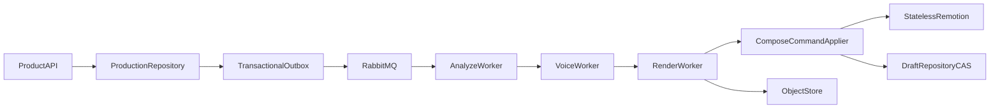
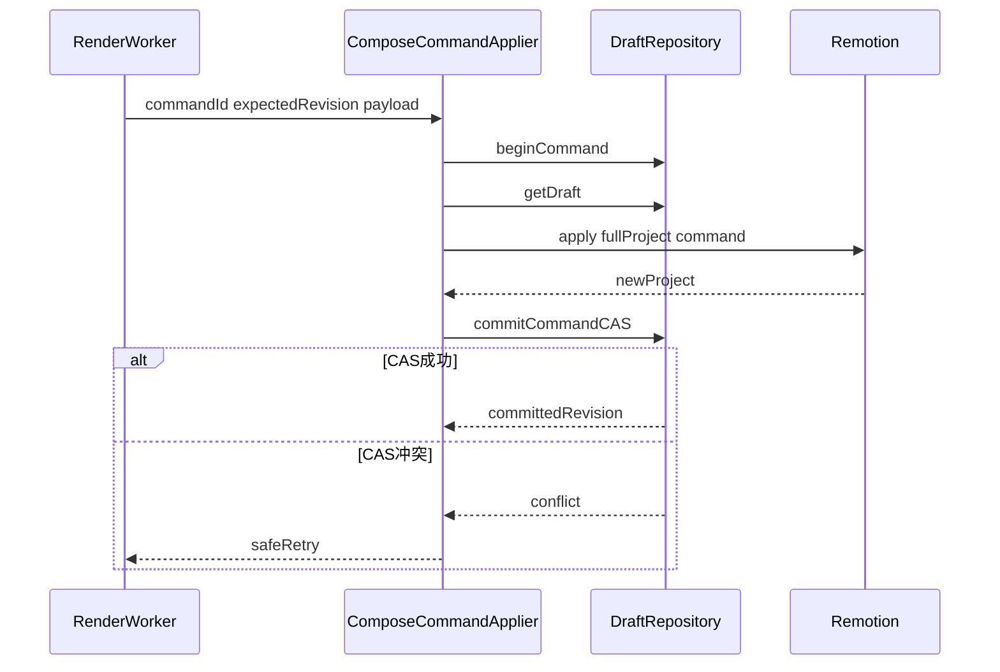

# 阶段 B：L0 无人值守闭环

本文定义 Comic 控制面阶段 B 的功能架构、逐文件职责、执行顺序和验收门禁。阶段 B
只交付 L0 可播放视频，不依赖拆层、眼嘴状态、自动审片或 ZIP。

## 1. 阶段目标

- 接受单页或多页漫画生产请求。
- 完成下载、分格、OCR、阅读顺序、TTS 和确定性时间线。
- 使用原图或 panel crop 生成 L0 工程。
- 经 CAS 提交工程，校验、规划批次、渲染并返回成片。
- 每个外部副作用均可幂等恢复、预算控制和审计。

非目标：L1/L2/L3、自动修正、联系表、交付材料包、第二套应用入口。

## 2. 核心架构

### 2.1 权威事实

| 事实 | 权威位置 |
| --- | --- |
| production、取消、状态、幂等 | PostgreSQL |
| draft revision、Compose 命令 | PostgreSQL |
| artifact、inputHash、成本、render batch | PostgreSQL |
| 大文件和成片 | Object Store |
| 持久 worker lease、outbox | PostgreSQL |
| 非权威短期锁、进度 | Redis |
| 任务分发 | RabbitMQ |

Remotion 是无状态 Compose/渲染服务。HTTP 200 不代表工程已提交；只有
`DraftRepository.commit_command_cas` 成功后，新的 draft revision 才是事实。



### 2.2 状态路径

```text
CREATED → INGESTING → ANALYZING → SYNTHESIZING_VOICE
→ PREPARING_ASSETS → COMPOSING → VALIDATING
→ PLANNING_BATCHES → RENDERING_BATCHES → DELIVERED
```

每次推进必须先提交当前阶段完成事实，再与下一阶段 outbox 原子提交。任意非终态可取消；
存在 L0 可播放 fallback 时不得进入 `PERMANENT_FAILED`。

### 2.3 稳定 ID 与幂等

- 产品受理：`tenantId + prodClientRequestId`。
- `pageId`：规范化源图字节哈希。
- `shotId`：page、panel、panelPartIndex 的稳定组合。
- `stableLineKey`：page、panel、气泡阅读序和规范化文本。
- artifact：`tenantId + stage + inputHash + providerConfigVersion`。
- Compose：确定性 commandId；重放不得增加 revision。
- render：工程 contentHash、帧范围、shotIds 生成 batchId。

外部 URL 必须为 HTTPS。产品金额用 RMB Decimal，仓储账本用整数 fen；换算只在仓储边界
执行一次。时间线使用整数 frame，供应商毫秒按 30fps 向上取整。

## 3. 数据契约

- `ProductionRequest`：产品请求，固定 1080×1920、30fps。
- `PanelSpec`：分格/OCR 结果，不直接写工程。
- `LineAudio`：每行音频或明确 missingReason。
- `TimedShotSpec`：真实音频完成后冻结的 shot 相对时间线。
- `AssetArtifact`：产物索引、checksum、inputHash 和成本事实。
- `ComposeCommandInput/Record`：工程命令账本。

`TimedDialogueSpec.fromFrame` 是 shot 内相对帧，写入 Remotion 时必须换算：

```text
absoluteFromFrame = committedShot.from + timedDialogue.fromFrame
```

## 4. 逐文件功能架构

### `api/product_routes.py`

- 四个固定端点：
  - `POST /v1/comic-productions`
  - `GET /v1/comic-productions/{productionId}`
  - `POST /v1/comic-productions/{productionId}/cancel`
  - `GET /v1/comic-productions/{productionId}/deliveries`
- 只做鉴权、校验、受理、查询和取消，不执行长任务。
- tenantId 只取鉴权上下文，不信任请求体。
- 受理事务原子写 production、产品幂等记录和首个 outbox。
- 同幂等键同请求返回原 production；请求哈希不同返回 409。
- 测试：202 回放、409、跨租户 404、终态取消、取消后禁止新付费任务。

### `analyzer/panel_analyzer.py`

- 下载已准入源图，调用分格/OCR/阅读顺序适配器。
- 输出排序后的 `PanelSpec[]`、panel crop、原始响应和 inputHash。
- 按 readingDirection 生成稳定 panelIndex 和 stableLineKey。
- 不采用供应商随机 ID，不推进 production 状态。
- 测试：LTR/RTL、多栏、无气泡、重复文本、供应商乱序和重放。

### `analyzer/panel_quality_gate.py`

- 确定性检查几何越界、面积、覆盖率、重叠率、阅读顺序和 OCR 置信度。
- 输出 accepted、warnings、fallbackReason、requiresManualReview。
- 失败时使用整页或安全 crop 生成 L0，不终止 production。
- 门禁内禁止调用生成模型或猜测性修改结果。

### `audio/voice_synthesizer.py`

- 按 stableLineKey 去重，解析 speaker→voice，执行预算 reserve/TTS/upload/settle。
- 先查 artifact inputHash；命中成功产物时禁止重复付费。
- 供应商已受理但超时时，按 providerRequestId 对账，不直接重付。
- 单行失败返回 missingReason，对应字幕强制可见，不使整页失败。
- 测试：缓存命中、预算不足、部分失败、重复回调和未知 speaker。

### `audio/timeline_planner.py`

- 使用真实音频时长生成 `TimedShotSpec`。
- 冻结 shot 时长、对白相对帧、cameraPresetId 和 seed。
- 保证对白不越界；超长 panel 按 panelPartIndex 拆分。
- 相同输入和 seed 输出必须一致。
- 项目小于 5 秒时依赖 `project/pad`；该接口未就绪前属于上线阻塞。

### `repositories/production_repository.py`

- 实现受理幂等、租户查询、状态 CAS、取消和阶段完成事实。
- 所有更新携带 expectedVersion/state；更新零行视为并发冲突。
- 状态 CAS 与 outbox 共用调用方事务。
- 测试：并发受理、陈旧 worker、并发取消和租户隔离。

### `repositories/artifact_repository.py`

- 按 stage/inputHash claim 和复用产物。
- 状态为 pending→running→succeeded/failed。
- 对象上传并校验 checksum 后才能标记 succeeded。
- 同一租户复用；默认禁止跨租户复用。

### `repositories/cost_repository.py`

- 实现预算 reserve、settle、release 和供应商对账。
- 全部金额持久化为整数 fen。
- operation key 幂等；重复 settle 不得重复扣费。
- 测试并发超卖、退款、取消释放和 80% 增强刹车。

### `repositories/render_repository.py`

- 保存 OutputBatch、renderId、bucketName、进度、重试次数、URL 和 checksum。
- 已有 renderId 的批次只轮询，不重新提交。
- 只重试失败 batch；所有必需批次成功后才形成渲染完成事实。

### `rendering/remotion_client.py`

- 负责 HTTP、超时、错误映射、allowlist URL 和稳定 contentHash。
- 写接口：`project/create`、`image/sequence`、`dialogue/add`、`dialogue/voice`、
  `shot/edit` 和未来的 `project/pad`。
- 只读/作业接口：`project/validate`、`project/summary`、`project/plan-batches`、
  `project/render-batches` 和 render progress。
- 写接口实现既有 `ComposeClient.apply`，只能由 `ComposeCommandApplier` 调用。
- 将远端错误映射为 code/message/retryable，并保留业务上下文。

### `storage/key_layout.py`

- 集中生成 `{tenantId}/{productionId}/` 下的对象 key。
- 固定目录：`source/`、`artifacts/`、`renders/`、`preview/`、`delivery/`。
- key 包含稳定业务 ID 和 checksum；拒绝路径穿越与未清洗文件名。

### `storage/object_store.py`

- 抽象流式上传/下载、HEAD、checksum、短期签名 URL、copy 和异步删除。
- 上传采用临时 key→校验→promote，未完成对象不得登记成功。
- 数据库保存稳定 object key，不永久保存签名 URL。

### `workers/analyze_worker.py`

- 编排 INGESTING/ANALYZING。
- 按页下载、分析、质量门禁并提交 PanelSpec artifacts。
- 全部页均有 accepted 或 fallback 事实后推进 SYNTHESIZING_VOICE。
- 不调用 TTS、分层或 Compose。

### `workers/voice_worker.py`

- 编排 SYNTHESIZING_VOICE。
- 按行复用或合成音频，提交 LineAudio 和 TimedShotSpec。
- 单行失败不重做成功行；完成后推进 PREPARING_ASSETS。

### `workers/render_worker.py`

- B 中直接把 analyzer crop 作为 L0，不依赖阶段 C 的 asset worker。
- 通过 Compose CAS 写 image sequence、dialogue、voice，编排 COMPOSING/VALIDATING。
- 锁定已提交 contentHash，再规划和渲染批次。
- 已有 renderId 只轮询；draft 改变后旧批次失效。
- 校验最终对象 checksum 后推进 DELIVERED。

### `tools/production.py`

- `start/status/cancel` 调用应用服务，不复制 API 业务逻辑。
- start 支持显式幂等键；status 展示状态、成本、降级和最近错误。

### `tools/project.py`

- `read/validate` 读取指定已提交 revision 并调用 validate/summary。
- 禁止本地 JSON 覆盖生产 draft。

### `tools/batch.py`

- `plan/render` 用于受控运维重试，必须绑定 production、revision、contentHash。
- 默认只重试失败 batch；force 也不得绕过预算和取消。

## 5. Compose 提交流程



稳定 Remotion ID：

```text
panel asset/item/track: {kind}:{shotId}:panel
dialogue item/track:    {kind}:{shotId}:dialogue:{lineId}
voice item/track:       {kind}:{shotId}:voice:{lineId}
```

## 6. 实施顺序

1. PostgreSQL 实现 Draft、StateTransition、Outbox、JobLease、Budget Protocol。
2. production/artifact/cost/render repositories。
3. key layout、object store、Remotion client。
4. analyzer 与质量门禁。
5. voice synthesizer 与 timeline planner。
6. analyze、voice、render workers。
7. Product API 与三个 tools。
8. 契约、仓储、适配器、崩溃恢复和端到端测试。

## 7. Definition of Done

- 两个并发 worker 只有一个能提交状态或 draft revision。
- Compose 命令重放不增加 revision。
- 状态和 outbox 原子提交，消息重复消费不重复付费。
- 供应商返回、对象上传、Compose 返回、CAS 后任一点崩溃均可恢复。
- 任意单行 TTS 失败仍可生成可播放视频。
- 10 页基准集无需人工改库即可到达 DELIVERED。
- B 路径不导入或启动 C/D/E 的模块。

## 8. 当前阻塞

1. PostgreSQL 驱动、生命周期、迁移和本地服务尚未接入。
2. `remotion_client.py` 及生产 HTTP client 尚未实现。
3. Remotion 缺 `project/pad` HTTP 路由。
4. `blurred-background-contain` 与当前普通 contain 不一致。
5. OutputBatch 等正式 agent 契约仍需补齐。

