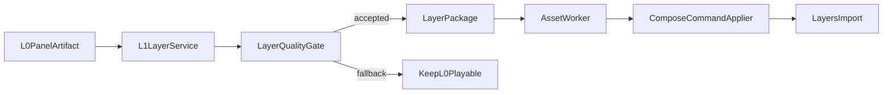

# 阶段 C：L1 人景分层

本文定义阶段 C 的 L1 人景分层功能架构。阶段 C 建立在阶段 B 已稳定交付 L0 的基础上；
任何分层失败都必须保留并回退 L0，不得重做分析、TTS 或使 production 永久失败。

## 1. 阶段目标与边界

- 为通过 B 的每个 shot 生成 clean background 和人物/前景图层。
- 用确定性质量门禁决定是否启用 L1。
- 通过既有 Compose CAS 导入 LayerPackage。
- 保存每个 shot 的 effectiveAnimationLevel 和降级原因。

非目标：眼嘴状态、L3、自动审片、任意工程 JSON patch、删除 L0 asset。

## 2. 依赖与状态

阶段 C 复用阶段 B 的 PostgreSQL、artifact/cost repositories、Object Store、
`ComposeCommandApplier`、预算、outbox、lease 和状态机，不复制控制面。



阶段 C 只扩展 `PREPARING_ASSETS → COMPOSING` 之间的素材能力。状态机不增加 L1 专用
业务状态；细粒度进度记录在 artifact 和 shot-level completion facts 中。

## 3. LayerPackage 契约

正式契约必须版本化并至少包含：

```text
schemaVersion
projectId
shotId
sourceUrl
canvas {width, height}
layers[] {
  layerId, name, semantic, imageUrl, zIndex, visible,
  bounds, anchor, confidence, motionPolicy
}
diagnostics {
  recompositionScore, alphaHoleRatio, edgeArtifactScore,
  requiresFallback, warnings[]
}
```

约束：

- sourceUrl/imageUrl 必须 HTTPS 且位于允许域名。
- layerId 在 shot 内唯一并可稳定重算。
- semantic 使用受控枚举，不接受供应商自由文本。
- canvas 必须与 L0 的逻辑画布一致。
- 质量阈值版本、模型版本和参数版本进入 inputHash。

## 4. 逐文件功能架构

### `assets/l0_panel.py`

- 把阶段 B 的 panel crop 或整页 fallback 正式登记为 L0 产物。
- 输出 panel URL、源尺寸、目标画布、shotId、默认可见性和诊断信息。
- 实现 `blurred-background-contain` 所需的描述参数，但不在 agent 做像素渲染。
- L1/L2 成功后只隐藏 L0 展示轨，不删除 asset。
- 任意增强回退时必须能恢复 L0 可见。
- 测试：极宽/极高图、整页 fallback、重复登记和可见性恢复。

### `assets/l1_layer_service.py`

- 输入：L0 panel artifact、shotId、租户策略、模型配置和预算上下文。
- 先计算 inputHash 并查询 artifact；命中成功产物时禁止再次付费。
- 预算 reserve 成功后调用分层/clean background 供应商。
- 规范化 bounds、anchor、zIndex、semantic 和 motionPolicy，上传各图层。
- 全部对象校验 checksum 后生成 LayerPackage 并 settle 成本。
- 供应商已受理但超时时按 providerRequestId 对账。
- 部分响应、损坏透明图或预算不足均返回结构化 fallback，不生成半成功包。
- 测试：缓存命中、部分产物、重复 layerId、供应商重放和预算停止增强。

### `assets/layer_quality_gate.py`

- 确定性检查：
  - recompositionScore；
  - alphaHoleRatio；
  - edgeArtifactScore；
  - 画布、bounds 和 anchor 一致性；
  - 必需图层、URL 可读性和 checksum；
  - zIndex 与 semantic 组合合法性。
- 输出 accepted/fallback、原因码、warnings 和 thresholdVersion。
- `requiresFallback=true` 时禁止调用 `layers/import`。
- 门禁不得调用生成模型，也不得静默修补供应商缺失文件。
- 测试：透明洞、残影、错位、尺寸不一致、遮挡错误和阈值边界。

### `workers/asset_worker.py`

- 在 C 启用时编排 PREPARING_ASSETS 的 L1 增强。
- 按 shot 领取 artifact claim；检查 production 是否取消和预算是否允许增强。
- 调用 L1 service 和 quality gate，提交成功或 fallback 完成事实。
- accepted 时构建稳定 Compose command，经 `ComposeCommandApplier` 调用
  `layers/import`。
- import CAS 成功后记录 effectiveAnimationLevel=L1，并隐藏 L0 展示轨。
- 任一失败记录 effectiveAnimationLevel=L0 和 downgradeReason，继续处理其他 shot。
- 所有 shot 至少有 L0 完成事实后才能推进 COMPOSING。
- 禁止直接写 draft、跨阶段重做分析/TTS 或删除 L0。

### `tools/layers.py`

- `prepare`：离线生成/校验 LayerPackage，仅用于受控运维。
- `import`：绑定 production、shotId、expectedRevision 和 package inputHash。
- import 仍通过 `ComposeCommandApplier`，不得直接请求 Remotion 后保存工程。
- 输出机器可读结果：commandId、revision、effectiveLevel、fallbackReason。
- 禁止导入任意本地 JSON、跨租户 URL 或未知 semantic。

## 5. Compose 适配

写接口：`POST /api/compose/layers/import`。

稳定 ID：

```text
layer asset: asset:{shotId}:{layerId}
layer item:  item:{shotId}:{layerId}
layer track: track:{shotId}:{layerId}
L0 track:    track:{shotId}:panel
```

导入事务语义：

1. 读取已提交 draft 和 expectedRevision。
2. 验证 LayerPackage 与目标 shot。
3. 调用 Remotion `layers/import`。
4. 新工程通过 CAS 提交。
5. CAS 成功后登记 command committed 和 L1 完成事实。

当前 Remotion `layers/import` 尚未完整实现“成功隐藏 L0、回退恢复 L0”。该能力未补齐前，
C 不得通过上线门禁。

## 6. 失败与降级矩阵

| 失败 | 动作 | 最终级别 |
| --- | --- | --- |
| 预算不足或增强刹车 | 不调用供应商，记录原因 | L0 |
| 供应商限流/临时错误 | 按 retry policy 重试 | L0 或 L1 |
| 供应商永久错误 | 保存诊断，不导入 | L0 |
| quality gate 拒绝 | 保存包和诊断，不导入 | L0 |
| Compose 协议错误 | 不提交 draft，安全重试/回退 | L0 |
| CAS 冲突 | 读取新 revision，按 commandId 重放 | L0 或 L1 |
| 单 shot 失败 | 其他 shot 继续增强 | 混合 L0/L1 |

只要 L0 可播放，任何 L1 失败都不能触发 `PERMANENT_FAILED`。

## 7. 实施顺序

1. 定义 LayerPackage、Layer、Diagnostics 正式契约。
2. 实现 L0 artifact 和稳定对象 key。
3. 实现 L1 service 及供应商适配。
4. 实现 layer quality gate。
5. 补齐 Remotion L0 显隐语义。
6. 实现 asset worker 的 C 路径。
7. 实现 layers tool。
8. 完成单元、契约、崩溃恢复和混合级别端到端测试。

## 8. Definition of Done

- 合格 LayerPackage 可幂等导入，同一 commandId 不增加 revision。
- L1 成功时隐藏 L0 展示但保留 asset，回退可恢复 L0。
- 任意单 shot 失败只降级该 shot。
- 重放、并发 worker 和 CAS 冲突不会重复付费。
- C 关闭后，阶段 B 的 L0 路径不受影响。
- 所有阈值、模型和参数版本均可审计并进入 inputHash。

