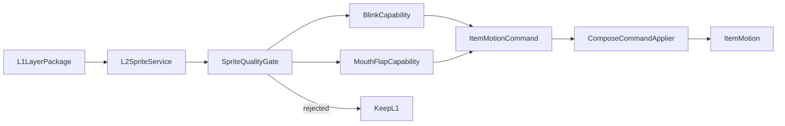

# 阶段 D：L2 眼嘴状态

本文定义阶段 D 的 L2 眼嘴状态图和 sprite motion 架构。阶段 D 只增强已通过阶段 C 的
L1 shot；失败时回退 L1，L1 不可用时继续保留 L0。L3 不在本阶段范围内。

## 1. 阶段目标

- 为人物 face/head 图层生成确定性的眼睛和嘴部状态资产。
- 独立判断 blink 和 mouth-flap 能力，允许局部降级。
- 通过 `item/motion` 将 spriteStates 写入工程。
- 保持 Player、preview 和 Lambda 渲染使用同一运动语义。

非目标：生成式视频、骨骼动画、无限动作预设、直接修改工程 JSON、重新分层。

## 2. 依赖与数据流

阶段 D 复用阶段 B/C 的 artifact、成本、Object Store、CAS、状态机和 asset worker。



阶段 D 不增加生产状态。每个 shot 的 L2 artifact、能力集合和降级原因是
`PREPARING_ASSETS` 的细粒度完成事实。

## 3. Sprite 契约

最小状态集合：

- eye：open、closed。
- mouth：closed、open；half 可选。

每个状态必须包含：

```text
shotId
semantic
assetId
imageUrl
width/height
bounds
anchor
checksum
modelVersion
inputHash
```

状态图必须共享同一画布、bounds 和 anchor 基准。ID 可由 shotId、部位和 semantic 稳定
推导，禁止使用供应商随机 ID。

## 4. 逐文件功能架构

### `assets/l2_sprite_service.py`

- 输入：已通过质量门禁的 L1 LayerPackage、对白和预算上下文。
- 定位 head/face/eye/mouth 语义图层，不重新执行人景分层。
- 先按 L1 checksum、模型版本、参数和所需状态计算 inputHash。
- 命中 artifact 时复用；否则 reserve 预算后调用状态图供应商。
- 规范化所有状态的 bounds、anchor、尺寸和透明通道，上传 Object Store。
- 输出状态资产集合，不直接生成或写入 spriteStates。
- 无对白 shot 可只生成 blink；缺少 face/head 时直接回退 L1。
- 供应商部分结果必须显式标记，不得伪造缺失状态。
- 测试：缓存、状态缺失、无对白、未知语义、超时对账和预算刹车。

### `assets/sprite_quality_gate.py`

- 检查状态完整性、轮廓漂移、anchor 漂移、画布一致性、透明边缘和 checksum。
- blink 与 mouth-flap 独立判定：
  - 眼睛失败不影响合格嘴型；
  - 嘴型失败不影响合格 blink；
  - 两者均失败时保持 L1。
- 输出 capabilities、rejectedReasons、thresholdVersion 和 diagnostics。
- 相同输入必须输出相同判定；门禁不得调用模型进行二次修复。
- 测试：单项失败、漂移阈值、状态命名冲突、透明污染和确定性。

### `workers/asset_worker.py`

- C 的 L1 accepted 后，根据租户 feature flag 和预算决定是否尝试 L2。
- 调用 sprite service 和 gate，逐 shot 提交 L2 artifact 完成事实。
- 根据 capabilities 生成一个或多个稳定 motion command。
- 每个命令均通过 `ComposeCommandApplier` CAS 提交。
- 至少一个能力提交成功时记录 effectiveAnimationLevel=L2。
- 所有能力失败时记录 downgradeReason 并保持 L1。
- 单 shot 失败不得影响其他 shot，不得重新执行 L1、分析或 TTS。

### `tools/motion.py`

- 构建受控 `item/motion` 命令，不允许任意 JSON patch。
- 支持：
  - blink：openAssetId、closedAssetId、seed；
  - mouth-flap：closed/half/openAssetId、dialogueItemIds；
  - 受控 item preset：breathing、float、hair-sway；
  - 受控 camera preset：camera-push、camera-pull、pan-left、pan-right。
- target、asset 和 dialogueItemIds 必须属于同一 tenant/production/shot。
- mode 默认 replace，append 只允许明确可组合预设。
- 输出 commandId、revision、capabilities 和 effectiveLevel。

## 5. Remotion `item/motion` 适配

请求结构：

```text
{
  project,
  mode: replace | append,
  target: item或shot,
  parameters?,
  seed?,
  keyframes?,
  cameraKeyframes?,
  sprite?: blink或mouth-flap
}
```

稳定 ID：

```text
eye item:       item:{shotId}:eye
mouth item:     item:{shotId}:mouth
eye state:      asset:{shotId}:eye:{semantic}
mouth state:    asset:{shotId}:mouth:{semantic}
dialogue item:  dialogue:{shotId}:{lineId}
```

所有 motion 命令必须基于已提交 draft 和 expectedRevision。Remotion 返回新工程后仍需
PostgreSQL CAS；远端成功但 CAS 冲突时不得直接标记 L2 成功。

## 6. 确定性规则

- blink seed 由 production/shot/策略版本稳定派生。
- mouth-flap 只引用已提交 dialogueItemIds。
- 相同 seed、对白时间线、资产和参数必须产生相同 spriteStates。
- 时间线或 draft contentHash 改变时，旧 motion artifact 不得复用。
- 状态切换不能超出 shot 边界。
- 所有随机过程必须显式 seed，禁止依赖进程时间或全局随机状态。

## 7. 降级矩阵

| 条件 | blink | mouth-flap | 最终级别 |
| --- | --- | --- | --- |
| 全部通过 | 开启 | 开启 | L2 |
| 眼状态失败 | 关闭 | 可开启 | L2 局部能力 |
| 嘴状态失败 | 可开启 | 关闭 | L2 局部能力 |
| 全部失败 | 关闭 | 关闭 | L1 |
| L1 不可用 | 关闭 | 关闭 | L0 |
| 预算禁止增强 | 不调用供应商 | 不调用供应商 | L1 |
| CAS 冲突 | 安全重放 | 安全重放 | 保持原级别直到提交 |

存在 L1/L0 fallback 时不得进入 `PERMANENT_FAILED`。

## 8. 实施顺序

1. 固化 sprite artifact 和 capability 契约。
2. 实现 L2 sprite service。
3. 实现 sprite quality gate。
4. 实现 motion command builder 和 tool。
5. 扩展 asset worker 的 D 路径。
6. 完成 Remotion item/motion 契约测试。
7. 完成局部降级、CAS 冲突和确定性端到端测试。

## 9. Definition of Done

- blink 与 mouth-flap 使用稳定 item/asset/dialogue ID。
- 相同输入和 seed 的 spriteStates 完全一致。
- 眼、嘴可独立失败和降级，最差保持 L1。
- motion 命令重放不增加 revision，不重复付费。
- D feature flag 关闭后，B/C 路径不受影响。
- 未实现、未注册、未暗中启用任何 L3 能力。

