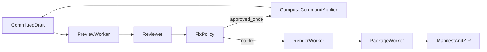

# 阶段 E：QA、预览与交付

本文定义阶段 E 的自动审片、有限修正、预览、材料包、租户策略、保留和告警架构。
阶段 E 可运行在 L0、L1 或 L2 工程上，不要求启用 C/D。

## 1. 阶段目标与边界

- 为当前已提交工程生成联系表帧、still 和低清预览。
- 输出带证据的结构化审片问题。
- 最多执行一轮白名单自动修正。
- 规划/渲染最终批次并构建确定性 manifest、play-order 和 ZIP。
- 完善租户配额、保留/撤销、异步删除和结构化告警。

禁止：LLM 直接修改工程 JSON、无限修正循环、重新执行已成功付费阶段、跨租户交付、
把签名 URL 写入永久 manifest。

## 2. 状态与数据流

```text
VALIDATING → PREVIEWING → REVIEWING
→ [FIXING → VALIDATING，最多一次]
→ PLANNING_BATCHES → RENDERING_BATCHES
→ PACKAGING → DELIVERED
```



preview、review、render 和 package 均绑定 draft revision/contentHash。工程改变后旧结果自动
过期，不得用于推进状态。

## 3. 逐文件功能架构

### `qa/reviewer.py`

- 输入：contact-sheet 帧、preview still、低清视频、project summary 和 contentHash。
- 输出结构化问题：code、severity、shotId、证据、建议动作、置信度。
- 无证据或低置信度问题只记录，不触发自动修正。
- 合并重复问题，保留模型/规则版本和原始审查 artifact。
- 不直接调用 Compose，不推进生产状态。
- 测试：空结果、重复问题、跨 shot 证据、过期预览和供应商失败。

### `qa/fix_policy.py`

- 把 reviewer 问题映射为有限、确定性的 Compose 命令计划。
- 允许：
  - 受限 shot 时长和 camera preset；
  - 受限 item motion 参数；
  - L2→L1→L0 降级；
  - 恢复字幕可见性等预定义动作。
- 禁止：
  - 任意 JSON patch；
  - 任意外部 URL；
  - 删除全部可播放素材；
  - 新增付费生成任务；
  - 第二轮自动修正。
- 输出 approved/rejected、reason、commands、expectedRevision 和预计成本。
- 修正完成后必须重新 VALIDATING；最多一次 FIXING 循环。

### `delivery/manifest_builder.py`

- 从已提交 production、draft、artifacts 和 render batches 构建确定性 manifest。
- 字段至少包含 schemaVersion、projectId、generatedAt、projectContentHash、
  playOrder、batches 和 files。
- 文件类别：source、panel、layer、manifest、audio、subtitle、project、preview、
  final-video。
- files 使用稳定路径排序；可选文件缺失写 missingReason。
- 必需 final-video 缺失时禁止完成 PACKAGING。
- generatedAt 不参与内容复用哈希，避免相同输入产生不同 package key。

### `delivery/package_builder.py`

- 流式收集 Object Store 对象并构建固定目录 ZIP。
- 目录：
  - `source/`
  - `panels/`
  - `layers/`
  - `audio/`
  - `subtitles/`
  - `preview/`
  - `videos/`
  - `project/`
  - `diagnostics/`
- 必含 `manifest.json`、`play-order.json`、`project/project.json`。
- 防 Zip Slip，限制单文件/总包大小，不在内存聚合大文件。
- 上传后校验 ZIP checksum 和 size，再登记交付成功。
- manifest contentHash 相同且对象可读时直接复用。

### `operations/tenant_policy.py`

- 从可信鉴权上下文解析 tenant，校验资源归属。
- 判定并发配额、日/月预算、功能阶段开关和交付权限。
- 缺 tenant、未知 tenant、跨租户或超配额默认拒绝。
- 策略只负责判定；状态、预算和配额事实仍由 repository 事务提交。
- 测试：跨租户、并发配额、管理员取消和 feature flag。

### `operations/retention_policy.py`

- 按租户、artifact 类别和交付状态计算 retainUntil。
- 删除流程：写 tombstone/outbox→异步幂等删除对象→记录结果。
- 数据库审计事实按合规策略保留，不能随对象一起无痕删除。
- legal hold 或仍被有效交付引用的对象不得删除。
- 交付撤销后旧签名 URL 必须失效或自然过期。

### `operations/alerting.py`

- 将结构化事实转换为可去重、可恢复的告警。
- 覆盖预算异常、lease 超时、outbox 堆积、渲染卡死、package 损坏和降级率突增。
- 去重键：tenant/production/stage/errorCode/timeWindow。
- 恢复时发送 resolve；告警通道失败不得改变 production 状态。
- 告警正文不得包含签名 URL、token、完整对白或完整工程。

### `workers/preview_worker.py`

- 编排 PREVIEWING。
- 调用 contact-sheet 获取帧位，再逐帧调用 preview-frame。
- 拼装联系表并生成低清预览，提交绑定 contentHash 的 artifacts。
- Remotion contact-sheet 当前只规划帧，不得把帧位响应记作联系表图片。
- draft contentHash 变化时丢弃过期结果并重新预览。
- 全部必需预览可读后推进 REVIEWING。

### `workers/package_worker.py`

- 编排 PACKAGING。
- 读取锁定 contentHash 的 manifest 输入和已成功 render batches。
- 调用 manifest builder、package builder，上传 ZIP 并校验 checksum。
- 交付记录和 DELIVERED 在同一业务提交中完成。
- 包装失败只重试包装，不得触发重新渲染。
- 相同 package inputHash 重放不得生成重复交付记录。

### `tools/review.py`

- `analyze`：对现有预览重跑 reviewer，不直接批准修正。
- `contact-sheet`：为当前 contentHash 生成或查询联系表。
- `preview`：生成/查询 still 或低清预览。
- 所有命令要求 tenant、production、revision/contentHash，拒绝过期工程。

### `tools/delivery.py`

- `package`：提交幂等 package job，不在 CLI 进程构建大型 ZIP。
- `delivery`：查询 manifest、playOrder、checksum、size 和有效交付状态。
- 只返回当前租户资源，签名 URL 按需短期生成。

## 4. Remotion 适配

### 预览

- `project/contact-sheet`：只返回 `{shotId, frame}` 规划。
- `project/preview-frame`：返回 still URL/taskId。
- 联系表图片由 agent 汇总 still 生成。

### 修正

仅通过 `ComposeCommandApplier` 调用白名单接口：

- `shot/edit`
- `item/motion`
- 恢复/降级所需的受控命令

每条命令都包含确定性 commandId 和 expectedRevision。

### 渲染和 manifest

- `project/plan-batches`
- `project/render-batches`
- render progress
- `project/export-package`

`export-package` 只生成 DeliveryPackageManifest，不打 ZIP、不下载文件。ZIP 始终由
`package_builder.py` 在 agent 侧构建。

## 5. 审片与修正门禁

```text
review input contentHash == current draft contentHash
AND fixingCount == 0
AND issue has evidence
AND action in allowlist
AND playable fallback remains
```

任一条件不满足时拒绝自动修正并继续使用当前可播放版本。FIXING 后必须重新 validate、
preview 和 review，但第二次 REVIEWING 只能通过或带问题交付，不能再次进入 FIXING。

## 6. 交付不变量

- playOrder 只引用已成功且 checksum 已确认的 final-video。
- batchId 与锁定 contentHash 一致。
- manifest 和 ZIP 内路径唯一且稳定排序。
- 永久 manifest 保存 object key/checksum，不保存短期签名 URL。
- ZIP 可重复构建且内容 checksum 一致。
- DELIVERED 表示交付对象可 HEAD、必需文件完整，而非“打包任务已提交”。

## 7. 失败与恢复

| 失败 | 恢复动作 |
| --- | --- |
| preview still 部分失败 | 只重试失败 frame |
| reviewer 不可用 | 按策略重试或跳过自动修正，保留当前可播放版本 |
| 白名单外问题 | 记录问题，不执行修正 |
| 修正 CAS 冲突 | 读取新 revision，旧 review 作废 |
| 单 batch 渲染失败 | 只重试失败 batch |
| ZIP 构建中断 | 从 package inputHash 重启包装 |
| ZIP 上传后本地超时 | HEAD/checksum 对账，不重复上传 |
| 告警通道失败 | 重试告警，不改变 production |

## 8. 实施顺序

1. 定义 ReviewIssue、FixPlan、OutputBatch、DeliveryPackageManifest 契约。
2. 实现 tenant policy 和 contentHash 过期判定。
3. 实现 preview worker。
4. 实现 reviewer 和 fix policy。
5. 实现 manifest/package builders 和 package worker。
6. 实现 review/delivery tools。
7. 实现 retention policy 和 alerting。
8. 完成一轮修正、过期预览、ZIP 恢复和租户隔离端到端测试。

## 9. Definition of Done

- 所有 review/preview artifacts 绑定当前 contentHash。
- 自动修正最多一轮且只产生白名单 Compose 命令。
- ZIP 目录、manifest、playOrder 和 checksum 可确定性重建。
- 包装失败不重复渲染，告警失败不改变状态。
- delivery 查询严格租户隔离。
- 保留、撤销和删除流程可幂等恢复。

## 10. 当前阻塞

1. contact-sheet 只规划帧，实际图片仍需 agent 拼装。
2. export-package 只生成 manifest，ZIP 仍需 agent 实现。
3. OutputBatch、DeliveryPackageManifest、ReviewIssue 等正式契约尚未补齐。
4. 多租户运行时接线、PostgreSQL 和 Object Store 适配仍依赖阶段 B 基础门禁。

